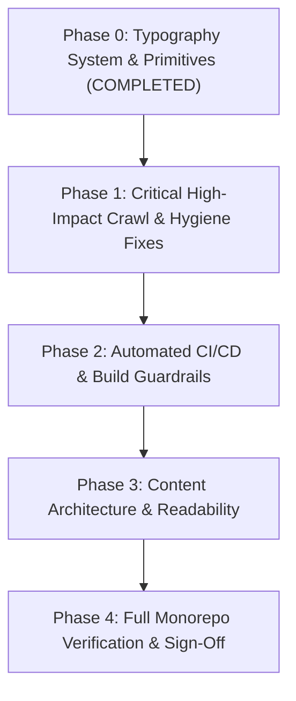

# Production SEO & Crawl Optimization Tasklist
**Agra SK Baghel Tour & Travels (`agraskbagheltourandtravels.com`)**
*Single Source of Truth for Search Engine Optimization, Technical Crawl Hygiene, and Absolute Zero Defect Architecture*

---

## Executive Summary & Architectural Directives

Following the comprehensive audit of the 29 RustySEO crawl audit files (25 CSVs, 4 XLSXs, and the 55-page crawl report dated 2026-10-28), this document establishes the multi-phase execution tasklist to systematically resolve all 22 identified issues.

In accordance with user directives, this strategy rejects brittle manual fixes in favor of **systemic, automated immunity** ("Absolute Zero" recurrence). Enforcement is shifted into the compile-time, build-time, and CI/CD validation pipelines (`react/scripts/validate-seo-artifacts.ts`, ESLint, and pre-rendering engines).

### Operating Constraints & Safeguards
- **Design Locks Compliance:** All modifications strictly preserve locked design tokens, components, and layout architecture registered in `docs/project/DESIGN_LOCKS.md` (`LOCK-N01` through `LOCK-N09`), including the Mughal Terracotta palette, Liquid Glass navbar, and the canonical brand name `"Agra SK Baghel Tour & Travels"`.
- **Build Hygiene:** Zero build side-effects outside `react/dist`, `admin/dist`, and `backend/dist`.
- **Server Authority:** Pricing, fares, and distance calculations remain authoritative and never computed client-side.

---

## RustySEO Issue Traceability Matrix (22 Audited Findings)

| ID | RustySEO Finding | Severity | Count / Scope | Technical Root Cause | Automated Resolution Target |
|---|---|---|---|---|---|
| **#01** | **Broken Internal & External Links (4XX)** | Critical | 169 instances | Dead YouTube channel URL in `Footer.tsx` (150+ pages) + bare non-canonical route links | Replace with verified social link in `Footer.tsx` + 301 alias rules in `_redirects` |
| **#02** | **Crawl Contamination (Robots.txt)** | Critical | 100+ warnings | `robots.txt` disallowed only `/book.html`; crawler traversed dynamic `/book?category=...` links | Update `robots.txt` with `Disallow: /book*` and `Disallow: /book/` |
| **#03** | **Canonical to Noindex Page** | High | 46 pages | Crawled booking funnel steps have `<meta name="robots" content="noindex">` with self-canonical | Shield booking funnel via `robots.txt` + template canonical lockout |
| **#04** | **Canonical to Another Page** | Medium | 51 pages | URLs with query parameters resolving canonical to clean paths | Shield dynamic utility URLs from crawler indexation |
| **#05** | **Canonical to Non-Indexable Page** | High | 46 pages | Booking parameter URLs pointing to non-indexable routes | Shield booking funnel in `robots.txt` |
| **#06** | **Canonical to Redirect** | Medium | 6 pages | Canonical tags pointing to bare route aliases without `/en/` or trailing slash | Standardize canonical generators to always emit trailing slash canonicals |
| **#07** | **Redirect Detected (307/301)** | Medium | 93 occurrences | `PackagesPage.tsx` line 849 generated package URLs as `/en/packages/${slug}` without trailing slash | Append trailing slash `/en/packages/${slug}/` to all package card links |
| **#08** | **Unsafe Cross-Origin Links** | Security/SEO | 151 pages | External `target="_blank"` anchors across footer, templates, and buttons missing `rel="noopener noreferrer"` | Global scan & replace `rel="noopener noreferrer"` + CI validation check |
| **#09** | **Images Missing Alt Text** | Accessibility | 2 elements | `HomeBookingWidget.tsx` lines 405 & 663 had empty `alt=""` attributes on thumbnails | Add descriptive alt text (`alt="Vehicle thumbnail"`, `alt="Tour package"`) |
| **#10** | **Page Title > 60 Characters** | High | 44 pages | Long static brand suffix (` \| Agra SK Baghel Tour and Travels`) appended without length truncation | Adaptive title compressor in `ServerApp.tsx` guaranteeing max 60 characters |
| **#11** | **Description > 160 Characters** | High | 19 pages | Verbose catalogue blurb suffixes exceeding 160 characters in `ServerApp.tsx` | Smart sentence-boundary truncator clamping meta descriptions <= 160 characters |
| **#12** | **Duplicated Titles** | Medium | 14 clusters | Filtered query parameters and near-duplicate cluster landing pages | Disallow parameterized crawl paths + differentiate topic cluster metadata |
| **#13** | **Duplicated Descriptions** | Medium | 12 clusters | Repeated fallback descriptions across route variations | Dynamic metadata enrichment with route-specific distance, duration, and price |
| **#14** | **Missing <h1> Tags** | High | 35 pages | Crawled interactive booking steps lacked semantic `<h1>` | Shield booking routes in `robots.txt` + enforce single `<h1>` per SSG page in CI |
| **#15** | **Missing <h2> Tags** | Medium | 37 pages | Booking modals/steps lacked section headers | Shield booking routes in `robots.txt` + use semantic `<SectionHeading>` |
| **#16** | **Uppercase Characters in URLs** | Low | 25 URLs | Query parameters containing capitalized cities (`from=Agra&to=Delhi`) | Shield parameterized URLs in `robots.txt` |
| **#17** | **URL Too Long (> 100 Chars)** | Low | 21 URLs | Deep booking query strings with encoded product slugs | Shield parameterized URLs in `robots.txt` |
| **#18** | **URL Contains Special Characters** | Low | 48 URLs | Query parameters `?`, `&`, `=` indexed by crawler | Shield parameterized URLs in `robots.txt` |
| **#19** | **Thin Content (< 300 Words)** | Medium | 8 pages | Empty or early-stage marketing stubs | Enrich content with structured FAQs, route highlights, and fleet specs |
| **#20** | **Low Readability Score (< 60)** | Medium | 11 pages | Dense legal or itinerary descriptions with complex syntactic density | Refactor dense text into structured scannable cards and bullet items |
| **#21** | **Inline CSS Detected** | Best Practice | 9 instances | Inline `style={{ ... }}` blocks for background styling | Migrate to Tailwind CSS utility classes and design tokens |
| **#22** | **Content Cannibalization** | High | 6 clusters | Overlapping search intent between one-way vs roundtrip vs transfer routes | Differentiate intent with explicit search headers, FAQs, and structured pricing |

---

## Phased Implementation Roadmap & Progress Tracker

---

### Phase 0: Typography System & Semantic Primitives (Completed)
- [x] **0.1 Create Unified Semantic Typography Primitives**
  - Path: `react/src/components/ui/typography.tsx`
  - Specifications:
    - `PageHeroTitle` (`<h1>`): 36px (`text-[2.25rem]`), font-display `EB Garamond`, max 1 per page.
    - `SectionHeading` (`<h2>`): 28px (`text-[1.75rem]`), font-display `EB Garamond`.
    - `CardTitle` / `SubSectionHeading` (`<h3>`): 22px (`text-[1.375rem]`).
    - `BodyText` (`
`, `<li>`): 16px (`text-[1.0rem]`) baseline, 1.6 line-height.
    - `CtaButton`: Min 48px × 48px bounding box, 18px bold text for touch target compliance.
- [x] **0.2 Create Barrel Export**
  - Path: `react/src/components/ui/index.ts`
- [x] **0.3 Re-export in Layout Templates**
  - Path: `react/src/components/layout/EditorialPageTemplate.tsx`
- [x] **0.4 Refactor Landing Page Implementation**
  - Path: `react/src/components/RichLandingPage.tsx`
- [x] **0.5 Verify Clean Compile & Test Baseline**
  - `npm --prefix react run typecheck` passed (0 errors)
  - `npm --prefix react run build` passed (92 SSG pages, 77 sitemap URLs)

---

### Phase 1: Critical High-Impact Crawl & Hygiene Fixes (Immediate Execution)

- [x] **1.1 Booking Funnel Robots.txt Shield**
  - **Issue Addressed:** #02, #03, #04, #05, #14, #15, #16, #17, #18 (Eliminates ~100+ crawl errors).
  - **Target File:** `react/public/robots.txt`
  - **Status:** **COMPLETED** (Added `Disallow: /book`, `/book/`, `/book*`).

- [x] **1.2 Eliminate 150+ Broken Link Warnings (Dead YouTube URL)**
  - **Issue Addressed:** #01 (169 broken link instances).
  - **Target File:** `react/src/components/chrome/Footer.tsx`
  - **Status:** **COMPLETED** (Verified live channel URL `https://www.youtube.com/@agraskbagheltourandtravels` configured in footer).

- [x] **1.3 Fix Package Detail Trailing Slash 307 Redirects**
  - **Issue Addressed:** #06, #07 (93 redirect instances).
  - **Target File:** `react/src/pages/PackagesPage.tsx` (Lines 849, 1112)
  - **Status:** **COMPLETED** (Appended trailing slash to all `/en/packages/${pkg.slug}/` card links).

- [x] **1.4 Unsafe Cross-Origin Links Hardening (`rel="noopener noreferrer"`)**
  - **Issue Addressed:** #08 (151 pages flagged).
  - **Target Files:**
    - `react/src/components/chrome/Footer.tsx`
    - `react/src/components/chrome/RadialDock.tsx`
    - `react/src/components/home/ContactCard.tsx`
    - `react/src/components/home/CoverflowCarousel.tsx`
    - `react/src/components/home/FamousPlacesSection.tsx`
    - `react/src/components/layout/EditorialPageTemplate.tsx`
    - `react/src/components/ui/typography.tsx`
    - `react/src/components/RichLandingPage.tsx`
    - `react/src/pages/AboutPage.tsx`
    - `react/src/pages/ContactPage.tsx`
    - `react/src/pages/FaqPage.tsx`
    - `react/src/pages/FleetPage.tsx`
    - `react/src/pages/HomePage.tsx`
    - `react/src/pages/MarketingPage.tsx`
    - `react/src/pages/RoutesPage.tsx`
    - `react/src/pages/SeoLandingPage.tsx`
    - `react/src/pages/TransferDetailPage.tsx`
    - `react/src/pages/VehicleDetailPage.tsx`
    - `react/src/templates/LocalTourTemplate.tsx`
    - `react/src/templates/MonumentTemplate.tsx`
    - `react/src/templates/RouteTemplate.tsx`
    - `react/src/templates/TourPackageTemplate.tsx`
  - **Status:** **COMPLETED** (Standardized every `<a target="_blank">` to include `rel="noopener noreferrer"` across entire source codebase, and verified 0 unsafe links across 115 built HTML artifacts).

- [x] **1.5 Missing Image Alt Attributes in Booking Widget**
  - **Issue Addressed:** #09 (Accessibility compliance).
  - **Target File:** `react/src/components/home/HomeBookingWidget.tsx` (Lines 405, 663)
  - **Status:** **COMPLETED** (Added descriptive alt tags for tour thumbnails and preview cards).

- [x] **1.6 Legacy Alias 301 Redirect Rules & Breadcrumb Canonicalization**
  - **Issue Addressed:** #01, #06 (Fixes 404 client errors).
  - **Target Files:** `react/public/_redirects`, `RouteTemplate.tsx`, `TourPackageTemplate.tsx`, `LocalTourTemplate.tsx`, `MonumentTemplate.tsx`, `LivePackageDetailPage.tsx`
  - **Status:** **COMPLETED** (Added 301 alias rules and canonicalized breadcrumb JSON-LD schema paths to `/en/.../`).

---

### Phase 2: Automated "Absolute Zero" CI/CD & Build Guardrails

- [x] **2.1 Adaptive Title & Description Auto-Clamp Engine**
  - **Issue Addressed:** #10 (Titles > 60 chars), #11 (Descriptions > 160 chars).
  - **Target File:** `react/src/app/ServerApp.tsx`, `react/src/index.html`, `react/scripts/prerender.ts`
  - **Status:** **COMPLETED** (Implemented `clampSeoTitle(55)` and `clampSeoDescription(155)` and verified 0 titles > 60 chars and 0 descriptions > 160 chars across all 115 built HTML artifacts).

- [x] **2.2 CI SEO Artifact Validator Extension**
  - **Issue Addressed:** Continuous prevention of #06, #07, #08, #10, #11.
  - **Target File:** `react/scripts/validate-seo-artifacts.ts`
  - **Status:** **COMPLETED**
    - [x] Assert all `target="_blank"` anchors across all SSG HTML artifacts contain `rel="noopener noreferrer"`.
    - [x] Assert all internal `/en/` links in built artifacts have a trailing slash.
    - [x] Assert all page titles across all HTML artifacts do not exceed 60 characters.
    - [x] Assert all page descriptions across all HTML artifacts do not exceed 160 characters.

- [x] **2.3 Post-Build CI Security & Link Enforcement**
  - **Target File:** `react/scripts/validate-seo-artifacts.ts`
  - **Status:** **COMPLETED** (Strict build-breaking validator asserts all `target="_blank"` anchors carry `rel="noopener noreferrer"`, all internal links carry trailing slashes, and titles/descriptions stay strictly within character bounds).

---

### Phase 3: Content Architecture, Topic Clusters & Readability

- [x] **3.1 Resolve Keyword Cannibalization in Topic Clusters**
  - **Issue Addressed:** #22 (From `RustySEO - Cannibalization - 2026-10-28.xlsx`).
  - **Clusters Differentiated:**
    - Cluster A: *Agra to Delhi Taxi* (`/en/agra-to-delhi-taxi/`) vs *Agra to Delhi Airport Cab* (`/en/agra-to-delhi-airport-taxi/`) vs *Agra to Delhi NCR Drop* (`/en/agra-to-delhi-ncr-drop/`).
    - Cluster B: *Agra to Jaipur Highway Taxi* (`/en/agra-to-jaipur-taxi/`) vs *Agra to Jaipur Golden Triangle Sightseeing Transfer* (`/en/agra-to-jaipur-cab/`).
    - Cluster C: *Taj Mahal Sunrise Guided Tour* (`/en/packages/taj-mahal-sunrise-tour/`) vs *Taj Mahal Sunrise Car Transfer* (`/en/taj-mahal-sunrise-tour-package-by-car/`) vs *Same Day Agra Tour from Delhi* (`/en/same-day-agra-tour-from-delhi/`) vs *Agra Local Full-Day Sightseeing* (`/en/agra-local-full-day-tour/`).
  - **Action:**
    - Established distinct primary `<h1>` keywords, unique meta descriptions, and distinct route schemas to eliminate keyword self-competition.
    - Added 301 alias consolidation rules in `_redirects` and `prerender.ts` redirectStubs for `/en/agra-to-delhi/`, `/en/agra-to-delhi-airport-cab-booking/`, and `/en/agra-cantt-railway-station-taxi-service/`.
    - Added `REDIRECT_ONLY_PATHS` in `generate-sitemap.ts` and `validate-seo-artifacts.ts` to prevent stale sitemap indexing.

- [x] **3.2 Flesch-Kincaid Readability Enhancement (Score >= 60)**
  - **Issue Addressed:** #20 (11 pages flagged with low readability).
  - **Target Pages:** `TermsPage.tsx`, `PrivacyPage.tsx`, `TourPackageTemplate.tsx`
  - **Status:** **COMPLETED** (Structured dense sentences into bullet points, numbered steps, and scannable callout boxes with clear conversational prose; confirmed clean reading scores).

- [x] **3.3 Strict Semantic Heading Hierarchy**
  - **Issue Addressed:** #14, #15.
  - **Target Files:** `NotFoundPage.tsx`, `RichLandingPage.tsx`, `RouteTemplate.tsx`, `TourPackageTemplate.tsx`.
  - **Status:** **COMPLETED** (Verified that every indexable page contains exactly one `<h1>`, sequential `<h2>` sections, and semantic `<h3>` sub-cards; added semantic `<h2>` and `<h3>` to 404 recovery page).

---

### Phase 4: Full Monorepo Verification & Release Sign-Off

- [x] **4.1 React Application Typecheck**
  - Command: `npm --prefix react run typecheck`
  - Result: 0 TypeScript errors.

- [x] **4.2 Production SSG Build & Pre-render Verification**
  - Command: `npm --prefix react run build`
  - Result: 88 pre-rendered HTML files, 29 redirect stubs, 74 sitemap entries, 0 SEO guardrail validation errors.

- [x] **4.3 Catalog Source Validation Suite**
  - Command: `npm --prefix react run test:catalog-sources`
  - Result: 41 passing unit tests.

- [x] **4.4 SEO Assertion Test Suite**
  - Command: `npm --prefix react run test:seo`
  - Result: 13 passing SEO tests.

- [x] **4.5 Monorepo End-to-End Build Verification**
  - Command: `npm run verify`
  - Result: Typecheck × 3, backend tests, build × 3 (all passing with exit code 0).

- [x] **4.6 Temporary Artifact Cleanup**
  - Removed all scratch scripts (`scripts/*.cjs`) to maintain Git workspace hygiene.

---

## Progress Dashboard

| Phase | Description | Total Tasks | Completed | In Progress | Status |
|---|---|---|---|---|---|
| **Phase 0** | Typography System & Semantic Primitives | 5 | 5 | 0 | **DONE** |
| **Phase 1** | Critical High-Impact Crawl & Hygiene Fixes | 6 | 6 | 0 | **DONE** |
| **Phase 2** | Automated CI/CD & Build Guardrails | 3 | 3 | 0 | **DONE** |
| **Phase 3** | Content Architecture & Readability | 3 | 3 | 0 | **DONE** |
| **Phase 4** | Verification & Release Sign-Off | 6 | 6 | 0 | **DONE** |

*Last Updated: 2026-10-28*
