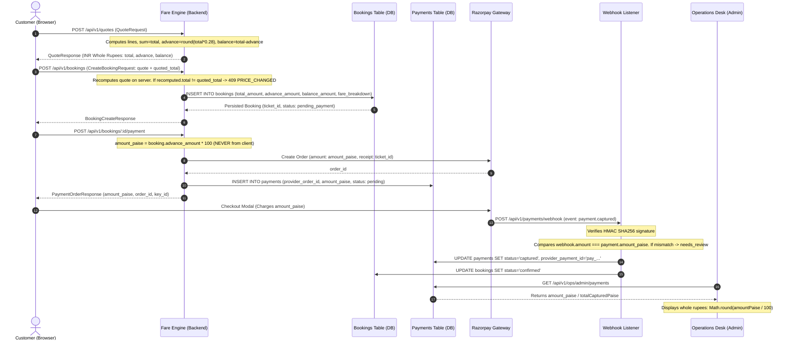

# SK Baghel Tour & Travels — Canonical Field Registry & Contract Normalization

> **Document Status:** Authoritative Architectural Standard & Field Registry  
> **Authority Sources:**  
> - Primary Specification: `fare-system-final-spec.md`  
> - Contract Source of Truth: `contracts/fare-system.ts` (`C-CONTRACT-ALL`, locked via `contracts/LOCKED.md`)  
> - Active Clean Migrations: `backend/migrations/0038_fare_system_clean_rebuild.sql`, `0039_fare_system_seeds.sql`  
> - Core Engine: `backend/src/modules/fare-engine/` (`calculators/`, `finalizer.ts`, `extra-charges.ts`, `rounding.ts`, `datetime.ts`)  
> - Authoritative Consumers: `react/src/services/cleanFareApi.ts`, `admin/src/lib/api.ts`, `backend/src/modules/bookings/`, `backend/src/modules/payments/`

---

## 1. Principles of Contract Preservation & Normalization

1. **Preserve Established Pricing Behavior:**  
   All calculation formulas, vehicle groups (`sedan`, `suv`, `luxury`, `tempo_traveller`), outstation distance formulas (`max(2 × d, 300 × days)`), driver allowances (₹500/₹700 per day), night charges (pickup in 20:00–06:00 IST), advance ratio (28% integer rupee rounding), and extra charge mechanics remain strictly preserved.
2. **Fail Closed on Financial Boundaries:**  
   No required monetary value may fall back to `0`, `null`, or an arbitrary alias. Client-supplied monetary amounts (`total_amount`, `advance_amount`, `balance_amount`, `rate_per_km`, `distance_km`) are strictly forbidden and rejected at canonical boundaries. The server alone calculates and authors pricing.
3. **Preserve Database History & Non-Destructive Migrations:**  
   Historical migrations (0001–0037) and active clean rebuild migrations (0038–0039) are immutable. No columns are dropped in production without a backward-compatible expand-and-contract sequence.
4. **Legitimate Layer Mapping vs. Ambiguous Aliases:**  
   Cross-layer transformations (PostgreSQL `snake_case` $\longleftrightarrow$ Zod Wire Contract `snake_case` $\longleftrightarrow$ TypeScript camelCase domain entities) are legitimate boundaries. Ambiguous intra-layer aliases (e.g. `total_fare` vs `total_amount` in a single layer) are resolved to the canonical field name.

---

## 2. Master Canonical Field Registry

### 2.1 Vehicle Groups (`vehicle_groups`)

| Business Concept | Database Column (`snake_case`) | Domain Field (`backend`) | Wire Contract (`API`) | Admin Desk Field | Customer Frontend Field | Type & Constraints | Currency Unit | Source of Truth |
| :--- | :--- | :--- | :--- | :--- | :--- | :--- | :--- | :--- |
| Group Identifier | `id` | `id` | `id` | `id` | `id` | UUID | N/A | PostgreSQL `vehicle_groups.id` |
| Group Code | `code` | `code` | `group_code` / `code` | `code` | `group_code` | Enum (`sedan`, `suv`, `luxury`, `tempo_traveller`) | N/A | PostgreSQL CHECK constraint |
| Group Display Name | `name` | `name` | `name` | `name` | `name` | String (min 1 char) | N/A | PostgreSQL `vehicle_groups.name` |
| Driver Allowance / Day | `driver_allowance_per_day` | `driver_allowance_per_day` | `driver_allowance_per_day` | `driver_allowance_per_day` | `driver_allowance_per_day` | Integer $\ge 0$ | INR Whole Rupees | PostgreSQL `vehicle_groups` |
| One-Way Night Charge | `one_way_night_charge` | `one_way_night_charge` | `one_way_night_charge` | `one_way_night_charge` | `one_way_night_charge` | Integer $\ge 0$ | INR Whole Rupees | PostgreSQL `vehicle_groups` |
| Round-Trip Halt / Night | `round_trip_halt_per_night` | `round_trip_halt_per_night` | `round_trip_halt_per_night` | `round_trip_halt_per_night` | `round_trip_halt_per_night` | Integer $\ge 0$ | INR Whole Rupees | PostgreSQL `vehicle_groups` |
| Sort Order | `sort_order` | `sort_order` | `sort_order` | `sort_order` | `sort_order` | Integer | N/A | PostgreSQL `vehicle_groups` |
| Active Status | `is_active` | `is_active` | `is_active` | `is_active` | `is_active` | Boolean | N/A | PostgreSQL `vehicle_groups` |

---

### 2.2 Vehicle Models (`vehicle_models`)

| Business Concept | Database Column (`snake_case`) | Domain Field (`backend`) | Wire Contract (`API`) | Admin Desk Field | Customer Frontend Field | Type & Constraints | Currency Unit | Source of Truth |
| :--- | :--- | :--- | :--- | :--- | :--- | :--- | :--- | :--- |
| Model Identifier | `id` | `id` | `vehicle_model_id` / `id` | `id` | `vehicle_model_id` | UUID | N/A | PostgreSQL `vehicle_models.id` |
| Vehicle Group FK | `vehicle_group_id` | `vehicle_group_id` | `vehicle_group_id` | `vehicle_group_id` | N/A | UUID FK | N/A | PostgreSQL FK `vehicle_groups(id)` |
| Make | `make` | `make` | `make` | `make` | `make` | String (e.g. 'Maruti', 'Toyota') | N/A | PostgreSQL `vehicle_models` |
| Model Name | `model_name` | `model_name` | `model_name` | `model_name` | `model_name` | String (e.g. 'Dzire', 'Crysta') | N/A | PostgreSQL `vehicle_models` |
| Display Name | `display_name` | `display_name` | `display_name` | `display_name` | `display_name` | String (e.g. 'Maruti Dzire') | N/A | PostgreSQL `vehicle_models` |
| Passenger Capacity | `passenger_capacity` | `passenger_capacity` | `passenger_capacity` | `passenger_capacity` | `passenger_capacity` | Integer $> 0$ | Seats | PostgreSQL CHECK constraint |
| Luggage Capacity | `luggage_capacity` | `luggage_capacity` | `luggage_capacity` | `luggage_capacity` | `luggage_capacity` | Integer $\ge 0$ or Null | Bags | PostgreSQL `vehicle_models` |
| Image URL | `image_url` | `image_url` | `image_url` | `image_url` | `image_url` | String / URL or Null | N/A | PostgreSQL `vehicle_models` |
| Sort Order | `sort_order` | `sort_order` | `sort_order` | `sort_order` | `sort_order` | Integer | N/A | PostgreSQL `vehicle_models` |
| Active Status | `is_active` | `is_active` | `is_active` | `is_active` | `is_active` | Boolean | N/A | PostgreSQL `vehicle_models` |

---

### 2.3 Global Commercial Parameters (`fare_settings`)

| Business Concept | Database Key (`key`) | Database Value (`value`) | Wire Contract Key | Domain Representation | Unit | Default | Validation Rule |
| :--- | :--- | :--- | :--- | :--- | :--- | :--- | :--- |
| Advance Percentage | `'advance_percent'` | `value` | `'advance_percent'` | `advance_percent` | Integer % | 28 | Between 1 and 100 |
| Minimum KM / Day | `'min_km_per_day'` | `value` | `'min_km_per_day'` | `min_km_per_day` | Kilometres | 300 | Integer $> 0$ |
| Max Round-Trip Days | `'max_round_trip_days'` | `value` | `'max_round_trip_days'` | `max_round_trip_days` | Calendar Days | 2 (seeded) / 5 (tested) | Integer $> 0$ |
| Night Window Start | `'night_start_hour'` | `value` | `'night_start_hour'` | `night_start_hour` | Hour (0–23 IST) | 20 | Between 0 and 23 |
| Night Window End | `'night_end_hour'` | `value` | `'night_end_hour'` | `night_end_hour` | Hour (0–23 IST) | 6 | Between 0 and 23 |

---

### 2.4 Outstation Routes & Vehicle Pricing (`outstation_routes` & `outstation_route_vehicles`)

| Business Concept | Database Column (`snake_case`) | Domain Field (`backend`) | Wire Contract (`API`) | Admin Desk Field | Customer Frontend Field | Type & Constraints | Currency Unit | Source of Truth |
| :--- | :--- | :--- | :--- | :--- | :--- | :--- | :--- | :--- |
| Route Identifier | `id` | `id` | `route_id` / `id` | `id` | `route_id` | UUID | N/A | PostgreSQL `outstation_routes.id` |
| Route Slug / Code | `code` | `code` | `code` | `code` | `code` | String (`^[a-z0-9-]{2,80}$`) | N/A | PostgreSQL `outstation_routes.code` |
| Origin City Name | `origin_name` | `origin_name` | `origin_name` | `origin_name` | `origin_name` | String | N/A | PostgreSQL `outstation_routes` |
| Destination City | `destination_name` | `destination_name` | `destination_name` | `destination_name` | `destination_name` | String | N/A | PostgreSQL `outstation_routes` |
| One-Way Distance | `distance_km` | `distance_km` | `distance_km` | `distance_km` | `distance_km` | Numeric(7,1) $> 0$ | Kilometres | Stored from LocationIQ lookup |
| Duration | `duration_minutes` | `duration_minutes` | `duration_minutes` | `duration_minutes` | `duration_minutes` | Integer $> 0$ | Minutes | Stored from LocationIQ lookup |
| Route Vehicle One-Way Rate | `one_way_amount` | `one_way_amount` | `one_way_amount` | `one_way_amount` | `one_way_amount` | Integer $> 0$ or Null | INR Whole Rupees | PostgreSQL `outstation_route_vehicles` |
| Round-Trip Enabled | `round_trip_enabled` | `round_trip_enabled` | `round_trip_enabled` | `round_trip_enabled` | `round_trip_enabled` | Boolean | N/A | PostgreSQL `outstation_route_vehicles` |
| Terms (Inclusions / Exclusions)| `terms` | `terms` | `terms` | `terms` | `inclusions`/`exclusions` | JSONB (`{ one_way, round_trip }`) | N/A | PostgreSQL `outstation_route_vehicles` |

---

### 2.5 Fare Calculation & Quote Envelope (`QuoteResponse`)

| Financial Concept | Quote Response Property | Quote Line Item Code | Type & Constraints | Currency Unit | Calculation Invariant | Source of Truth |
| :--- | :--- | :--- | :--- | :--- | :--- | :--- |
| Base Fare Line | `lines[code='base_fare']` | `'base_fare'` | Integer $> 0$ | INR Whole Rupees | One-way: `one_way_amount`; Round-trip: `round_half_up(billable_km × rate_per_km)` | Fare Engine (`one-way.ts` / `round-trip.ts`) |
| Driver Allowance Line | `lines[code='driver_allowance']` | `'driver_allowance'` | Integer $> 0$ | INR Whole Rupees | Round-trip only: `days × driver_allowance_per_day` | Fare Engine (`round-trip.ts`) |
| Night Charge Line | `lines[code='night_charge']` | `'night_charge'` | Integer $> 0$ | INR Whole Rupees | One-way only: `group.one_way_night_charge` if pickup hour $\in [20, 06)$ IST | Fare Engine (`one-way.ts`) |
| Halt Charge Line | `lines[code='halt_charge']` | `'halt_charge'` | Integer $> 0$ | INR Whole Rupees | Round-trip only: `nights × round_trip_halt_per_night` | Fare Engine (`round-trip.ts`) |
| Extra Charge Line | `lines[code='extra_charge']` | `'extra_charge'` | Integer $> 0$ | INR Whole Rupees | Applicable rows in `extra_charges` with amount $> 0$ | Fare Engine (`extra-charges.ts`) |
| **Total Fare** | `total` | N/A | Integer $> 0$ | INR Whole Rupees | **INV-1:** `total === sum(lines.map(l => l.amount))` | Fare Engine Finalizer (`finalizer.ts`) |
| **Advance Deposit** | `advance` | N/A | Integer $\ge 0$ | INR Whole Rupees | **INV-2:** `advance === min(total, round_half_up(total × advance_percent / 100))` | Fare Engine Finalizer (`finalizer.ts`) |
| **Balance Payable** | `balance` | N/A | Integer $\ge 0$ | INR Whole Rupees | **INV-3:** `advance + balance === total` | Fare Engine Finalizer (`finalizer.ts`) |

---

### 2.6 Booking Persistence (`bookings` Table)

| Business Concept | Database Column (`snake_case`) | Domain Entity (`backend`) | API Contract (`BookingDetailResponse`) | Desk Projection (`AdminService`) | Type & Constraints | Currency Unit | Fail-Closed Policy |
| :--- | :--- | :--- | :--- | :--- | :--- | :--- | :--- |
| Booking ID | `id` | `id` | `booking_id` | `id` | UUID PK | N/A | Required |
| Ticket Number | `ticket_id` | `ticket_id` | `ticket_id` | `ticketId` | Text (`AGR-YYYYMMDD-XXXX`) | N/A | Unique, server-generated |
| User Profile FK | `user_id` | `user_id` | `user_id` | `userId` | UUID Nullable | N/A | Optional |
| Guest Access Token | `guest_access_token` | `guest_access_token` | Secret | Secret | Text (64 hex characters) | N/A | Required, unique |
| Customer Name | `customer_name` | `customer_name` | `customer_name` | `customerName` | Text | N/A | Required |
| Customer Phone | `customer_phone` | `customer_phone` | `customer_phone` | `customerPhone` | Text | N/A | Required |
| Customer Email | `customer_email` | `customer_email` | `customer_email` | `customerEmail` | Text Nullable | N/A | Optional |
| Category | `category` | `category` | `category` | `category` | Text (`outstation`, `local_package`, `transfer`, `tour_package`) | N/A | Required |
| Vehicle Model FK | `vehicle_model_id` | `vehicle_model_id` | `vehicle_model.id` | `vehicleModelId` | UUID FK | N/A | Required |
| Passenger Count | `passenger_count` | `passenger_count` | `passenger_count` | `passengerCount` | Integer $> 0$ | Seats | Must $\le$ model capacity |
| Pickup Timestamp | `pickup_at` | `pickup_at` | `pickup_at` | `pickupDatetime` | TIMESTAMPTZ | ISO 8601 | Required, must be in future |
| Return Timestamp | `return_at` | `return_at` | `return_at` | `returnDatetime` | TIMESTAMPTZ Nullable | ISO 8601 | Required if round-trip |
| Pickup Address | `pickup_address` | `pickup_address` | `pickup_address` | `pickupAddress` | Text | N/A | Required |
| Drop Address | `drop_address` | `drop_address` | `drop_address` | `dropAddress` | Text Nullable | N/A | Optional |
| Full Quote Breakdown | `fare_breakdown` | `fare_breakdown` | `fare_breakdown` | `fareSnapshot` | JSONB (`QuoteResponse`) | N/A | Complete audit snapshot |
| **Total Amount** | `total_amount` | `total_amount` | `total_amount` | `totalFare` | **Integer $> 0$** | **INR Whole Rupees** | **Fail closed: cannot be null, 0, or negative** |
| **Advance Amount** | `advance_amount` | `advance_amount` | `advance_amount` | `advanceAmount` | **Integer $\ge 0$** | **INR Whole Rupees** | **Fail closed: must satisfy $\le \text{total}$** |
| **Balance Amount** | `balance_amount` | `balance_amount` | `balance_amount` | `balanceAmount` | **Integer $\ge 0$** | **INR Whole Rupees** | **Generated column: `total_amount - advance_amount`** |
| Lifecycle Status | `status` | `status` | `status` | `status` | Text (`pending_payment`, `confirmed`, `driver_assigned`, `in_transit`, `completed`, `cancelled`) | N/A | Required |

---

### 2.7 Payment Persistence & Gateway Gateway (`payments` Table)

| Business Concept | Database Column (`snake_case`) | Domain Entity (`backend`) | API Contract (`PaymentOrderResponse`) | Admin Desk Representation | Type & Constraints | Currency Unit | Fail-Closed Policy |
| :--- | :--- | :--- | :--- | :--- | :--- | :--- | :--- |
| Payment ID | `id` | `id` | `payment_id` | `id` | UUID PK | N/A | Required |
| Booking FK | `booking_id` | `booking_id` | `booking_id` | `bookingId` | UUID FK | N/A | Required |
| Provider Name | `provider` | `provider` | Provider | `provider` | Text (`'razorpay'`) | N/A | Required |
| Provider Order ID | `provider_order_id` | `provider_order_id` | `order_id` | `providerOrderId` | Text (`order_...`) | N/A | Required, unique |
| Provider Payment ID | `provider_payment_id` | `provider_payment_id` | `provider_payment_id` | `providerPaymentId` | Text Nullable (`pay_...`) | N/A | Stored upon capture |
| **Payment Amount** | `amount_paise` | `amount_paise` | `amount_paise` | `amountMinor` / `amount` (₹ = paise / 100) | **BigInt $> 0$** | **INR Paise** | **Strictly $\text{booking.advance\_amount} \times 100$. Never client-supplied.** |
| Payment Status | `status` | `status` | `status` | `status` | Text (`'pending'`, `'captured'`, `'failed'`, `'needs_review'`) | N/A | Required |
| Failure Reason | `failure_reason` | `failure_reason` | `failure_reason` | `failureReason` | Text Nullable | N/A | Stored upon failure |

---

## 3. End-to-End Financial Value Trace

---

## 4. Legitimate Mappings vs. Disallowed Aliases

### 4.1 Legitimate Mappings Across Boundaries
- **Database (`snake_case`) $\longleftrightarrow$ Public API Wire Contract (`snake_case`):**
  - `bookings.total_amount` $\longleftrightarrow$ `BookingDetailResponse.total_amount` (Direct 1:1)
  - `bookings.advance_amount` $\longleftrightarrow$ `BookingDetailResponse.advance_amount` (Direct 1:1)
  - `bookings.balance_amount` $\longleftrightarrow$ `BookingDetailResponse.balance_amount` (Direct 1:1)
  - `payments.amount_paise` $\longleftrightarrow$ `PaymentOrderResponse.amount_paise` (Direct 1:1)
- **Database (`snake_case`) $\longleftrightarrow$ Admin Projection Domain Entity (`camelCase`):**
  - `bookings.total_amount` $\longleftrightarrow$ `BookingRecord.totalFare`
  - `bookings.advance_amount` $\longleftrightarrow$ `BookingRecord.advanceAmount`
  - `bookings.balance_amount` $\longleftrightarrow$ `BookingRecord.balanceAmount`
  - `payments.amount_paise` $\longleftrightarrow$ `PaymentRecord.amountMinor` / `PaymentRecord.inrAmountPaise`
  - `payments.amount_paise / 100` $\longleftrightarrow$ Admin Desk UI `Payment.amount` (whole INR rupees display)

### 4.2 Disallowed Anti-Patterns & Removed Aliases
- **Fuzzy Zero Fallbacks (`?? 0` on financial totals):**  
  Eliminated from `mapBooking` and `mapPayment`. Any null, NaN, or non-positive amount throws `AppError("DATA_CORRUPTION", ...)` to fail closed immediately.
- **Client Price Injection:**  
  Client cannot submit `total_amount`, `advance_amount`, or `balance_amount`. Only `quoted_total` is accepted as an optimistic assertion, verified strictly against the server's recomputed quote.
- **Silent Degradation to Alternative Keys:**  
  Within the clean database layer, `total_fare`, `inr_amount_paise`, and `amount_minor` do not exist in `bookings` and `payments`. The database writes and reads canonical columns `total_amount`, `advance_amount`, and `amount_paise`.
