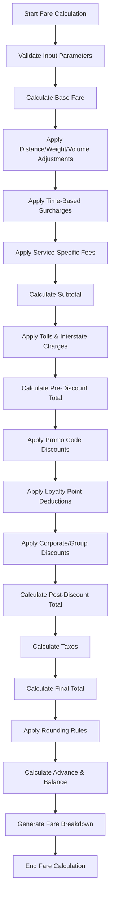
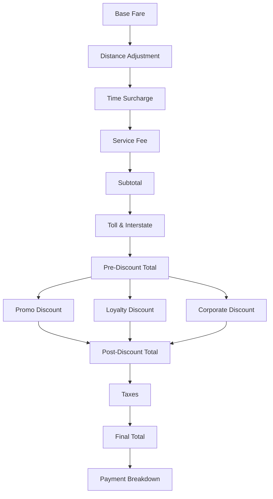

# Fare Calculation Business Logic — Agra SK Baghel Tour & Travels

**Document Version:** 1.0.0  
**Status:** Production-Ready Fare Calculation Specification  
**Last Updated:** 2026-11-01

---

## 1. Executive Summary

This document defines the **complete, authoritative business logic** for calculating total fare and all associated charges for customer bookings on the Agra SK Baghel Tour & Travels platform.

### Key Principles

| Principle | Implementation |
|-----------|----------------|
| **Server-Authoritative** | All calculations performed on backend; client prices ignored |
| **Deterministic** | Same inputs always produce same outputs |
| **Transparent** | Every charge component documented and traceable |
| **Configurable** | Business rules via database settings, not hardcoded |
| **Composable** | Charge components can be combined in any order |

---

## 2. Fare Component Hierarchy

### 2.1 Primary Charge Components

```
┌─────────────────────────────────────────────────────────────────────────────┐
│                           TOTAL FARE                                        │
│  ┌───────────────────────────────────────────────────────────────────────┐  │
│  │  SUBTOTAL (Sum of all base charges)                                   │  │
│  │  ┌─────────────────────────────────────────────────────────────────┐  │  │
│  │  │  BASE FARE                                                      │  │  │
│  │  │  ├─ Distance/Weight/Volume-Based Rate Adjustments              │  │  │
│  │  │  ├─ Time-Based Surcharges (Peak Hours, Night Rates)            │  │  │
│  │  │  └─ Service-Specific Fees (Fuel, Handling, Insurance)          │  │  │
│  │  └─────────────────────────────────────────────────────────────────┘  │  │
│  │  ┌─────────────────────────────────────────────────────────────────┐  │  │
│  │  │  ADD-ON CHARGES                                                 │  │  │
│  │  │  ├─ Tolls                                                        │  │  │
│  │  │  ├─ Interstate Charges                                           │  │  │
│  │  │  └─ Optional Services (Insurance, Priority Booking)            │  │  │
│  │  └─────────────────────────────────────────────────────────────────┘  │  │
│  └───────────────────────────────────────────────────────────────────────┘  │
│  ┌───────────────────────────────────────────────────────────────────────┐  │
│  │  DEDUCTIONS                                                           │  │
│  │  ├─ Promo Code Discounts                                             │  │
│  │  ├─ Loyalty Point Deductions                                         │  │
│  │  └─ Corporate/Group Discounts                                        │  │
│  └───────────────────────────────────────────────────────────────────────┘  │
│  ┌───────────────────────────────────────────────────────────────────────┐  │
│  │  TAXES                                                                │  │
│  │  ├─ GST (18% on most services)                                       │  │
│  │  ├─ CESS (if applicable)                                             │  │
│  │  └─ Service Tax (if applicable)                                      │  │
│  └───────────────────────────────────────────────────────────────────────┘  │
└─────────────────────────────────────────────────────────────────────────────┘
```

### 2.2 Charge Component Categories

| Category | Component | Type | Conditional | Description |
|----------|-----------|------|-------------|-------------|
| **Base Fare** | `base_fare` | Fixed/Variable | Always | Core transportation cost |
| **Distance-Based** | `distance_charge` | Variable | Distance > 0 | Per-kilometer rate applied |
| **Weight-Based** | `weight_charge` | Variable | Weight > 0 | Per-kilogram rate applied |
| **Volume-Based** | `volume_charge` | Variable | Volume > 0 | Per-cubic-meter rate applied |
| **Time-Based** | `peak_hour_surcharge` | Variable | Peak hours | Additional charge during high-demand periods |
| **Time-Based** | `night_surcharge` | Variable | Night hours | Additional charge for night travel |
| **Toll/Charges** | `toll_charge` | Variable | Tolls on route | Highway/bridge tolls |
| **Toll/Charges** | `interstate_charge` | Variable | Cross-state | Interstate entry fees |
| **Discounts** | `promo_discount` | Negative | Valid promo | Customer promo code discount |
| **Taxes** | `gst` | Variable | Taxable | 18% GST on taxable amount |
| **Taxes** | `cess` | Variable | Taxable | Additional cess (if any) |

---

## 3. Order of Operations

### 3.1 Sequential Calculation Flow



### 3.2 Detailed Step-by-Step Calculation

#### Step 1: Input Validation

```typescript
interface FareCalculationInput {
  // Trip Information
  tripType: "one-way" | "round-trip" | "local-tour" | "airport-transfer";
  origin: string;
  destination: string;
  pickupDatetime: string; // ISO 8601 with timezone
  returnDatetime?: string; // Required for round-trip
  
  // Vehicle Information
  vehicleTier: string;
  passengerCount: number;
  luggageWeightKg?: number;
  cargoVolumeCbm?: number;
  
  // Distance Information
  distanceKm: number;
  estimatedDurationMinutes: number;
  
  // Route Information
  routeId?: string;
  tolls: TollCharge[];
  interstateCrossings: InterstateCharge[];
  
  // Customer Information
  promoCode?: string;
  loyaltyPoints?: number;
  isCorporateCustomer: boolean;
  customerTier?: "gold" | "silver" | "bronze" | null;
  
  // Configuration Overrides
  fareVersion: string;
  ruleOverrides?: FareRuleOverrides;
}
```

#### Step 2: Calculate Base Fare

```typescript
function calculateBaseFare(input: FareCalculationInput): number {
  const { vehicleTier, distanceKm, tripType } = input;
  
  // Get base fare configuration
  const vehicleSpec = getVehicleSpec(vehicleTier);
  const routeFare = getRouteFare(input);
  
  // Determine pricing model
  if (routeFare?.pricingModel === "fixed") {
    // Fixed fare for predefined routes/packages
    return routeFare.fares[vehicleTier] || 0;
  } else if (routeFare?.pricingModel === "per-km") {
    // Per-km pricing
    return roundRupees(distanceKm * vehicleSpec.perKmRate);
  } else if (tripType === "local-tour") {
    // Local package pricing
    const localPackage = getLocalPackage(input);
    return localPackage?.fares[vehicleTier] || 0;
  } else {
    // Default: per-km calculation
    return roundRupees(distanceKm * vehicleSpec.perKmRate);
  }
}
```

#### Step 3: Apply Distance/Weight/Volume Adjustments

```typescript
interface DistanceAdjustment {
  baseDistanceKm: number;
  additionalDistanceKm: number;
  ratePerKm: number;
}

function calculateDistanceAdjustments(
  baseFare: number,
  input: FareCalculationInput
): DistanceAdjustment {
  const { distanceKm, vehicleTier, tripType } = input;
  const vehicleSpec = getVehicleSpec(vehicleTier);
  
  // Get minimum billable distance based on trip type
  const minBillableDistance = getMinBillableDistance(tripType, vehicleTier);
  
  // Calculate billable distance
  const billableDistance = Math.max(distanceKm, minBillableDistance);
  
  // Calculate additional distance beyond base
  const additionalDistance = Math.max(0, billableDistance - vehicleSpec.baseDistanceKm);
  
  // Apply per-km rate for additional distance
  const additionalDistanceCharge = roundRupees(additionalDistance * vehicleSpec.perKmRate);
  
  return {
    baseDistanceKm: vehicleSpec.baseDistanceKm,
    additionalDistanceKm: additionalDistance,
    ratePerKm: vehicleSpec.perKmRate,
  };
}
```

#### Step 4: Apply Time-Based Surcharges

```typescript
interface TimeSurcharge {
  type: "peak_hour" | "night";
  amount: number;
  condition: string;
}

function calculateTimeSurcharges(input: FareCalculationInput): TimeSurcharge[] {
  const surcharges: TimeSurcharge[] = [];
  const { pickupDatetime, tripType, vehicleTier } = input;
  
  // Get IST pickup hour
  const pickupHour = getIstHour(pickupDatetime);
  
  // Night surcharge (20:00 - 06:00 IST)
  const isNightPickup = pickupHour >= 20 || pickupHour < 6;
  if (isNightPickup && tripType !== "local-tour") {
    const nightRate = getNightAllowanceRate(vehicleTier);
    surcharges.push({
      type: "night",
      amount: nightRate,
      condition: `Pickup time ${pickupHour}:00 is within night window (20:00-06:00 IST)`,
    });
  }
  
  // Peak hour surcharge (08:00-11:00, 17:00-21:00 IST)
  const isPeakHour = 
    (pickupHour >= 8 && pickupHour < 11) || 
    (pickupHour >= 17 && pickupHour < 21);
  if (isPeakHour && tripType === "airport-transfer") {
    const peakRate = getPeakHourSurcharge(vehicleTier);
    surcharges.push({
      type: "peak_hour",
      amount: peakRate,
      condition: `Pickup time ${pickupHour}:00 is within peak hours (08:00-11:00, 17:00-21:00 IST)`,
    });
  }
  
  return surcharges;
}
```

#### Step 5: Apply Service-Specific Fees

```typescript
interface ServiceFee {
  type: "fuel" | "handling" | "insurance";
  amount: number;
  condition: string;
}

function calculateServiceFees(input: FareCalculationInput): ServiceFee[] {
  const fees: ServiceFee[] = [];
  const { vehicleTier, luggageWeightKg, cargoVolumeCbm, isCorporateCustomer } = input;
  
  // Fuel surcharge (dynamic based on fuel price index)
  const fuelPriceIndex = getFuelPriceIndex();
  if (fuelPriceIndex > 1.2) { // Threshold for surcharge
    const fuelSurcharge = roundRupees(fuelPriceIndex * 100); // Base surcharge
    fees.push({
      type: "fuel",
      amount: fuelSurcharge,
      condition: `Fuel price index ${fuelPriceIndex} exceeds threshold 1.2`,
    });
  }
  
  // Handling charge (for cargo services)
  if (luggageWeightKg && luggageWeightKg > 20) {
    const handlingCharge = roundRupees((luggageWeightKg - 20) * 10); // ₹10/kg excess
    fees.push({
      type: "handling",
      amount: handlingCharge,
      condition: `Luggage weight ${luggageWeightKg}kg exceeds free allowance 20kg`,
    });
  }
  
  // Insurance charge (optional)
  if (input.cargoVolumeCbm && input.cargoVolumeCbm > 0) {
    const insuranceRate = isCorporateCustomer ? 0.005 : 0.01; // 0.5% or 1%
    const insuranceCharge = roundRupees(input.cargoVolumeCbm * 1000 * insuranceRate);
    fees.push({
      type: "insurance",
      amount: insuranceCharge,
      condition: `Cargo volume ${input.cargoVolumeCbm}CBM requires insurance`,
    });
  }
  
  return fees;
}
```

#### Step 6: Calculate Subtotal

```typescript
function calculateSubtotal(
  baseFare: number,
  distanceAdjustments: DistanceAdjustment,
  timeSurcharges: TimeSurcharge[],
  serviceFees: ServiceFee[]
): number {
  const distanceCharge = distanceAdjustments.baseDistanceKm > 0 
    ? baseFare 
    : distanceAdjustments.additionalDistanceKm * distanceAdjustments.ratePerKm;
  
  const timeSurchargeTotal = timeSurcharges.reduce((sum, s) => sum + s.amount, 0);
  const serviceFeeTotal = serviceFees.reduce((sum, s) => sum + s.amount, 0);
  
  return roundRupees(baseFare + distanceCharge + timeSurchargeTotal + serviceFeeTotal);
}
```

#### Step 7: Apply Tolls & Interstate Charges

```typescript
function calculateTollAndInterstateCharges(input: FareCalculationInput): number {
  const { tolls, interstateCrossings } = input;
  
  const tollTotal = tolls.reduce((sum, t) => sum + t.amount, 0);
  const interstateTotal = interstateCrossings.reduce((sum, i) => sum + i.amount, 0);
  
  return roundRupees(tollTotal + interstateTotal);
}
```

#### Step 8: Apply Promo Code Discounts

```typescript
interface PromoDiscount {
  code: string;
  amount: number;
  type: "percentage" | "fixed";
  condition: string;
}

function calculatePromoDiscount(
  preDiscountTotal: number,
  promoCode?: string
): PromoDiscount {
  if (!promoCode) {
    return { code: "", amount: 0, type: "fixed", condition: "No promo code provided" };
  }
  
  const promo = lookupPromoCode(promoCode);
  
  if (!promo || !promo.isActive) {
    return { code: promoCode, amount: 0, type: "fixed", condition: "Promo code not found or inactive" };
  }
  
  // Check validity
  if (promo.validFrom && new Date(promo.validFrom) > new Date()) {
    return { code: promoCode, amount: 0, type: "fixed", condition: "Promo code not yet valid" };
  }
  
  if (promo.validTo && new Date(promo.validTo) < new Date()) {
    return { code: promoCode, amount: 0, type: "fixed", condition: "Promo code expired" };
  }
  
  if (promo.minTotal && preDiscountTotal < promo.minTotal) {
    return { code: promoCode, amount: 0, type: "fixed", condition: `Minimum order ₹${promo.minTotal} not met` };
  }
  
  // Calculate discount
  let discountAmount = 0;
  if (promo.discountType === "percentage") {
    discountAmount = roundRupees(preDiscountTotal * (promo.discountValue / 100));
  } else {
    discountAmount = promo.discountValue;
  }
  
  // Cap at total
  discountAmount = Math.min(discountAmount, preDiscountTotal);
  
  return {
    code: promoCode.toUpperCase(),
    amount: discountAmount,
    type: promo.discountType,
    condition: promo.description,
  };
}
```

#### Step 9: Apply Loyalty Point Deductions

```typescript
interface LoyaltyDiscount {
  pointsUsed: number;
  amount: number;
  conversionRate: number; // e.g., 100 points = ₹1
  condition: string;
}

function calculateLoyaltyDiscount(
  preDiscountTotal: number,
  loyaltyPoints?: number,
  customerTier?: string
): LoyaltyDiscount {
  if (!loyaltyPoints || loyaltyPoints === 0) {
    return { pointsUsed: 0, amount: 0, conversionRate: 100, condition: "No loyalty points available" };
  }
  
  const conversionRate = getLoyaltyConversionRate(customerTier);
  const maxRedeemable = Math.floor(preDiscountTotal * conversionRate);
  const pointsToUse = Math.min(loyaltyPoints, maxRedeemable);
  
  return {
    pointsUsed: pointsToUse,
    amount: roundRupees(pointsToUse / conversionRate),
    conversionRate,
    condition: `Redeemed ${pointsToUse} points (100 = ₹1)`,
  };
}
```

#### Step 10: Apply Corporate/Group Discounts

```typescript
interface CorporateDiscount {
  discountPercent: number;
  amount: number;
  condition: string;
}

function calculateCorporateDiscount(
  postPromoTotal: number,
  isCorporateCustomer: boolean,
  customerTier?: string
): CorporateDiscount {
  if (!isCorporateCustomer) {
    return { discountPercent: 0, amount: 0, condition: "Not a corporate customer" };
  }
  
  const discountPercent = getCorporateDiscountRate(customerTier);
  
  return {
    discountPercent,
    amount: roundRupees(postPromoTotal * (discountPercent / 100)),
    condition: `Corporate ${customerTier} tier discount ${discountPercent}%`,
  };
}
```

#### Step 11: Calculate Taxes

```typescript
interface TaxBreakdown {
  gst: number;
  cess: number;
  totalTax: number;
  taxableAmount: number;
}

function calculateTaxes(postDiscountTotal: number): TaxBreakdown {
  // GST is 18% on taxable amount
  const gst = roundRupees(postDiscountTotal * 0.18);
  
  // Cess (if applicable)
  const cess = 0; // Currently not applicable
  
  return {
    gst,
    cess,
    totalTax: roundRupees(gst + cess),
    taxableAmount: postDiscountTotal,
  };
}
```

#### Step 12: Calculate Final Total

```typescript
function calculateFinalTotal(
  postDiscountTotal: number,
  taxBreakdown: TaxBreakdown
): number {
  return roundRupees(postDiscountTotal + taxBreakdown.totalTax);
}
```

#### Step 13: Apply Rounding Rules

```typescript
function applyRounding(total: number): number {
  // Round to nearest ₹100
  return roundToNearestHundred(total);
}

function roundToNearestHundred(amount: number): number {
  return Math.round(amount / 100) * 100;
}
```

#### Step 14: Calculate Advance & Balance

```typescript
interface PaymentBreakdown {
  totalFare: number;
  advanceAmount: number;
  balanceAmount: number;
  advancePercent: number;
}

function calculatePaymentBreakdown(totalFare: number): PaymentBreakdown {
  // Advance: 28% of total, rounded to nearest ₹100, minimum ₹500
  const rawAdvance = roundToNearestHundred(totalFare * 0.28);
  const advanceAmount = Math.max(500, Math.min(totalFare, rawAdvance));
  const balanceAmount = Math.max(0, totalFare - advanceAmount);
  
  return {
    totalFare,
    advanceAmount,
    balanceAmount,
    advancePercent: 28,
  };
}
```

---

## 4. Conditional Rules and Dependencies

### 4.1 Fare Component Dependencies



### 4.2 Conditional Component Activation

| Component | Activation Condition | Deactivation Condition |
|-----------|---------------------|----------------------|
| `base_fare` | Always active | Never |
| `distance_charge` | `distanceKm > 0` | `distanceKm = 0` |
| `night_surcharge` | `pickupHour >= 20 OR pickupHour < 6` AND `tripType != "local-tour"` | `pickupHour >= 6 AND pickupHour < 20` OR `tripType = "local-tour"` |
| `peak_hour_surcharge` | `pickupHour in [8-11, 17-21]` AND `tripType = "airport-transfer"` | `pickupHour not in [8-11, 17-21]` OR `tripType != "airport-transfer"` |
| `fuel_surcharge` | `fuelPriceIndex > 1.2` | `fuelPriceIndex <= 1.2` |
| `handling_charge` | `luggageWeightKg > 20` | `luggageWeightKg <= 20` |
| `insurance_charge` | `cargoVolumeCbm > 0` | `cargoVolumeCbm = 0` |
| `toll_charge` | `tolls.length > 0` | `tolls.length = 0` |
| `interstate_charge` | `interstateCrossings.length > 0` | `interstateCrossings.length = 0` |
| `promo_discount` | `promoCode` is valid | `promoCode` invalid/expired |
| `loyalty_discount` | `loyaltyPoints > 0` | `loyaltyPoints = 0` |
| `corporate_discount` | `isCorporateCustomer = true` | `isCorporateCustomer = false` |
| `gst` | Always active (taxable amount > 0) | `taxableAmount = 0` |

### 4.3 Priority Rules

1. **Promo codes cannot be applied to group commercial vehicles** (Tempo, Urbania) unless explicitly allowed
2. **Loyalty discounts cannot exceed 50% of fare**
3. **Corporate discounts cannot be combined with promo codes** (customer chooses one)
4. **Taxes are always calculated on post-discount total**
5. **Advance payment is always 28% of final total, minimum ₹500**

---

## 5. Configuration and Overrides

### 5.1 Database Configuration

```sql
-- Fare settings table
CREATE TABLE fare_settings (
  id UUID PRIMARY KEY DEFAULT uuid_generate_v4(),
  setting_key VARCHAR(100) UNIQUE NOT NULL,
  setting_value JSONB NOT NULL,
  description TEXT,
  is_active BOOLEAN DEFAULT true,
  created_at TIMESTAMPTZ DEFAULT NOW(),
  updated_at TIMESTAMPTZ DEFAULT NOW()
);

-- Example settings
INSERT INTO fare_settings (setting_key, setting_value, description) VALUES
('night_surcharge_rates', '{"sedan": 300, "ertiga": 300, "innova": 300, "tempo_traveller": 500, "urbania": 500}', 'Night surcharge per vehicle tier'),
('peak_hour_surcharge_rates', '{"sedan": 100, "ertiga": 100, "innova": 150, "tempo_traveller": 200, "urbania": 300}', 'Peak hour surcharge per vehicle tier'),
('fuel_surcharge_threshold', '1.2', 'Fuel price index threshold for surcharge'),
('loyalty_conversion_rate', '100', 'Points required for ₹1'),
('loyalty_max_redemption_percent', '50', 'Maximum fare percentage redeemable with points'),
('corporate_discount_rates', '{"gold": 15, "silver": 10, "bronze": 5}', 'Corporate discount by tier');
```

### 5.2 Rule Overrides

```typescript
interface FareRuleOverrides {
  // Distance-based
  minKmPerDay?: number;
  sameDayRoundMultiplier?: number;
  
  // Time-based
  nightStartHour?: number; // Default: 20
  nightEndHour?: number; // Default: 6
  nightChargeInr?: number; // Override per-night charge
  nightHaltInr?: number; // Alternative night charge
  
  // Service-based
  fuelSurchargeEnabled?: boolean;
  handlingChargePerKg?: number;
  insuranceRatePercent?: number;
  
  // Tolls
  tollAmountInr?: number;
  tollIncluded?: boolean;
  
  // Discounts
  promoAllowGroupVehicles?: boolean;
  loyaltyMaxRedemptionPercent?: number;
  corporateDiscountEnabled?: boolean;
  
  // Rounding
  roundToNearest?: number; // Default: 100
}
```

---

## 6. Complete Fare Calculation Algorithm

### 6.1 Pseudocode

```
FUNCTION calculateFare(input: FareCalculationInput): FareBreakdown
  // Step 1: Validate input
  IF NOT validateInput(input)
    THROW ValidationError
  
  // Step 2: Calculate base fare
  baseFare = calculateBaseFare(input)
  
  // Step 3: Apply distance adjustments
  distanceAdjustments = calculateDistanceAdjustments(baseFare, input)
  distanceCharge = distanceAdjustments.baseDistanceKm > 0 
    ? baseFare 
    : distanceAdjustments.additionalDistanceKm * distanceAdjustments.ratePerKm
  
  // Step 4: Apply time surcharges
  timeSurcharges = calculateTimeSurcharges(input)
  timeSurchargeTotal = SUM(timeSurcharges[].amount)
  
  // Step 5: Apply service fees
  serviceFees = calculateServiceFees(input)
  serviceFeeTotal = SUM(serviceFees[].amount)
  
  // Step 6: Calculate subtotal
  subtotal = baseFare + distanceCharge + timeSurchargeTotal + serviceFeeTotal
  
  // Step 7: Apply tolls and interstate charges
  tollAndInterstate = calculateTollAndInterstateCharges(input)
  
  // Step 8: Calculate pre-discount total
  preDiscountTotal = subtotal + tollAndInterstate
  
  // Step 9: Apply promo discount
  promoDiscount = calculatePromoDiscount(preDiscountTotal, input.promoCode)
  promoAmount = promoDiscount.amount
  
  // Step 10: Apply loyalty discount
  loyaltyDiscount = calculateLoyaltyDiscount(preDiscountTotal - promoAmount, input.loyaltyPoints, input.customerTier)
  loyaltyAmount = loyaltyDiscount.amount
  
  // Step 11: Apply corporate discount
  corporateDiscount = calculateCorporateDiscount(preDiscountTotal - promoAmount - loyaltyAmount, input.isCorporateCustomer, input.customerTier)
  corporateAmount = corporateDiscount.amount
  
  // Step 12: Calculate post-discount total
  postDiscountTotal = preDiscountTotal - promoAmount - loyaltyAmount - corporateAmount
  
  // Step 13: Calculate taxes
  taxBreakdown = calculateTaxes(postDiscountTotal)
  taxTotal = taxBreakdown.totalTax
  
  // Step 14: Calculate final total
  finalTotal = postDiscountTotal + taxTotal
  
  // Step 15: Apply rounding
  roundedTotal = applyRounding(finalTotal)
  
  // Step 16: Calculate payment breakdown
  paymentBreakdown = calculatePaymentBreakdown(roundedTotal)
  
  // Step 17: Build fare breakdown
  RETURN {
    baseFare,
    distanceCharge,
    timeSurcharges,
    serviceFees,
    tollAndInterstate,
    promoDiscount,
    loyaltyDiscount,
    corporateDiscount,
    taxBreakdown,
    totalFare: paymentBreakdown.totalFare,
    advanceAmount: paymentBreakdown.advanceAmount,
    balanceAmount: paymentBreakdown.balanceAmount,
    rules: [
      "base_fare:calculated",
      "distance_charge:applied",
      "time_surcharges:applied",
      "service_fees:applied",
      "toll_charge:applied",
      "promo_discount:applied",
      "loyalty_discount:applied",
      "corporate_discount:applied",
      "taxes:calculated",
      "rounding:applied"
    ]
  }
END FUNCTION
```

### 6.2 TypeScript Implementation

```typescript
// backend/src/modules/fares/fare.calculator.ts

export interface FareBreakdown {
  // Base components
  baseFare: number;
  distanceCharge: number;
  
  // Time-based
  timeSurcharges: TimeSurcharge[];
  nightSurcharge: number;
  peakHourSurcharge: number;
  
  // Service-based
  serviceFees: ServiceFee[];
  fuelSurcharge: number;
  handlingCharge: number;
  insuranceCharge: number;
  
  // Tolls
  tollAndInterstate: number;
  tollCharges: TollCharge[];
  interstateCharges: InterstateCharge[];
  
  // Discounts
  promoDiscount: PromoDiscount;
  loyaltyDiscount: LoyaltyDiscount;
  corporateDiscount: CorporateDiscount;
  
  // Taxes
  taxBreakdown: TaxBreakdown;
  
  // Payment
  totalFare: number;
  advanceAmount: number;
  balanceAmount: number;
  advancePercent: number;
  
  // Metadata
  rules: string[];
  fareVersion: string;
  calculatedAt: string;
}

export function calculateFare(input: FareCalculationInput): FareBreakdown {
  // ... implementation as described above
}
```

---

## 7. Examples and Test Cases

### 7.1 Example 1: One-Way Outstation Trip

**Input:**
- Trip: Agra → Delhi (one-way)
- Vehicle: Innova Crysta
- Distance: 220 km
- Pickup: 2026-11-01T10:00:00+05:30 (10:00 IST, daytime)
- No promo, no loyalty points, non-corporate

**Calculation:**
1. Base Fare: ₹3,500 (catalog rate for Innova)
2. Distance Charge: ₹0 (within billable km)
3. Time Surcharge: ₹0 (daytime pickup)
4. Service Fees: ₹0
5. Tolls: ₹400 (Yamuna Expressway toll)
6. Subtotal: ₹3,900
7. Promo Discount: ₹0
8. Loyalty Discount: ₹0
9. Corporate Discount: ₹0
10. Taxable Amount: ₹3,900
11. GST (18%): ₹702
12. Final Total: ₹4,602
13. Rounded Total: ₹4,600
14. Advance (28%): ₹1,288 → ₹1,300 (rounded to ₹100)
15. Balance: ₹3,300

### 7.2 Example 2: Round-Trip with Night Pickup

**Input:**
- Trip: Delhi → Agra (round-trip)
- Vehicle: Sedan
- Distance: 220 km
- Pickup: 2026-11-01T22:30:00+05:30 (22:30 IST, night)
- Return: 2026-11-02T18:00:00+05:30
- Promo: WELCOME10 (10% off)
- Loyalty: 500 points
- Non-corporate

**Calculation:**
1. Base Fare: ₹2,200 (catalog rate for Sedan)
2. Round-trip multiplier: 1.85x
3. Distance Charge: ₹2,200 (within billable km)
4. Time Surcharge: ₹300 (night pickup for Sedan)
5. Service Fees: ₹0
6. Tolls: ₹400
7. Subtotal: ₹2,900
8. Pre-Discount Total: ₹3,300
9. Promo Discount (10%): ₹330
10. Loyalty Discount (500 points = ₹5): ₹5
11. Corporate Discount: ₹0
12. Post-Discount Total: ₹2,965
13. GST (18%): ₹534
14. Final Total: ₹3,499
15. Rounded Total: ₹3,500
16. Advance (28%): ₹980 → ₹1,000 (rounded to ₹100, min ₹500)
17. Balance: ₹2,500

### 7.3 Example 3: Local Tour with Promo

**Input:**
- Trip: Agra Sightseeing (8hr-80km)
- Vehicle: Ertiga
- Pickup: 2026-11-01T09:00:00+05:30 (peak hour)
- Promo: LOCAL15 (15% off)
- Loyalty: 1000 points
- Corporate customer (Silver tier: 10% discount)

**Calculation:**
1. Base Fare: ₹2,600 (catalog rate for Ertiga)
2. Distance Charge: ₹0 (fixed package)
3. Time Surcharge: ₹0 (local tour, no night/peak)
4. Service Fees: ₹0
5. Tolls: ₹0
6. Subtotal: ₹2,600
7. Pre-Discount Total: ₹2,600
8. Promo Discount (15%): ₹390
9. Loyalty Discount (1000 points = ₹10): ₹10
10. Corporate Discount (10%): ₹210
11. Post-Discount Total: ₹1,990
12. GST (18%): ₹358
13. Final Total: ₹2,348
14. Rounded Total: ₹2,300
15. Advance (28%): ₹644 → ₹600 (rounded to ₹100)
16. Balance: ₹1,700

---

## 8. Error Handling

### 8.1 Validation Errors

| Error Code | Description | HTTP Status |
|------------|-------------|-------------|
| `INVALID_DISTANCE` | Distance must be positive | 400 |
| `INVALID_DATETIME` | Pickup datetime must be in future | 400 |
| `INVALID_VEHICLE_TIER` | Vehicle tier not found | 400 |
| `INVALID_PROMO_CODE` | Promo code format invalid | 400 |
| `PROMO_NOT_ELIGIBLE` | Promo not applicable to vehicle/trip | 400 |
| `INSUFFICIENT_LOYALTY_POINTS` | Not enough loyalty points | 400 |

### 8.2 Business Rule Errors

| Error Code | Description | HTTP Status |
|------------|-------------|-------------|
| `GROUP_VEHICLE_PROMO_NOT_ALLOWED` | Group commercial vehicles cannot use promo codes | 400 |
| `MINIMUM_ORDER_NOT_MET` | Promo requires minimum order value | 400 |
| `PROMO_EXPIRED` | Promo code has expired | 400 |
| `PROMO_LIMIT_REACHED` | Promo redemption limit reached | 400 |

---

## 9. Performance Considerations

### 9.1 Caching Strategy

| Component | Cache Duration | Cache Key |
|-----------|---------------|-----------|
| Vehicle specs | 24 hours | `vehicle_spec:{tier}` |
| Route fares | 1 hour | `route_fare:{origin}:{destination}` |
| Promo codes | 5 minutes | `promo:{code}` |
| Fuel price index | 1 hour | `fuel_price_index` |
| Loyalty rates | 1 hour | `loyalty_rates:{tier}` |

### 9.2 Optimization Tips

1. **Batch fare calculations** for multiple vehicles when showing options
2. **Cache intermediate results** for complex calculations
3. **Use database views** for frequently accessed fare configurations
4. **Implement rate limiting** for fare calculation API

---

## 10. Audit and Logging

### 10.1 Required Audit Fields

```typescript
interface FareCalculationAudit {
  requestId: string;
  input: FareCalculationInput;
  breakdown: FareBreakdown;
  calculatedAt: string;
  calculatedBy: string; // User ID or system
  ipAddress: string;
  userAgent: string;
}
```

### 10.2 Logging Requirements

1. Log all fare calculations with full breakdown
2. Log promo code validations
3. Log loyalty point redemptions
4. Log corporate discounts applied
5. Log any overrides applied

---

## 11. Future Enhancements

### 11.1 Dynamic Pricing

- **Surge pricing** during high-demand periods
- **Seasonal pricing** for peak travel seasons
- **Last-minute pricing** for unsold inventory

### 11.2 Advanced Discounts

- **Bundle discounts** for multiple bookings
- **Referral discounts** for new customers
- **Seasonal promotions** based on calendar events

### 11.3 Internationalization

- **Multi-currency support** with FX conversion
- **Tax variations** by country/state
- **Local pricing** based on customer location

---

## 12. Document Control

| Field | Value |
|-------|-------|
| **Document Version** | 1.0.0 |
| **Status** | Production-Ready |
| **Last Updated** | 2026-11-01 |
| **Author** | Agra SK Baghel Tour & Travels Engineering Team |
| **Reviewers** | Product, Finance, Operations |
| **Next Review** | 2027-01-01 |

---

*This document is the authoritative source for fare calculation business logic. All implementations must conform to this specification.*
