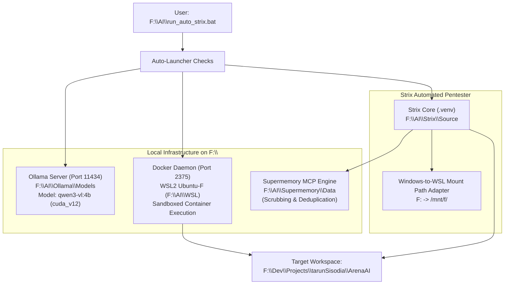

# Strix AI Security Scanner — Automated Runbook & Guide

> **Single-Click Automated AI Penetration Testing & Vulnerability Scanner for SK Baghel Tour & Travels (ArenaAI).**  
> Powered by **Strix**, local GPU-accelerated **Ollama (`qwen3-vl:4b`)**, **WSL2 Docker Sandbox**, and persistent **Supermemory MCP**.  
> **100% Isolated on `F:\` Drive** — Zero pressure on `C:\`.

---

## 🚀 1. Quick Start (Everything Auto-Ready)

You don't need to manually configure Docker or Ollama every time. The auto-launcher checks and boots dependencies automatically.

### Option A: One-Click Launch (Command Prompt / PowerShell)
Simply run:

```cmd
F:\AI\run_auto_strix.bat
```

### Option B: Double Click in Windows Explorer
Navigate to `F:\AI` and double-click **`run_auto_strix.bat`**.

---

## ⚙️ What the Auto-Launcher Does Automatically

When you run `run_auto_strix.bat`, it executes the following automated pipeline:

1. **Checks Ollama LLM Service** on `http://localhost:11434`:
   - If offline, boots `F:\AI\run_ollama.bat` with `cuda_v12` GPU runner in the background.
2. **Checks Docker Daemon** on `tcp://127.0.0.1:2375`:
   - If offline, boots the WSL2 Docker service (`Ubuntu-F` distro on `F:\AI\WSL`) in the background.
3. **Injects Windows-to-WSL Docker Bind Mount Patch**:
   - Host repository paths (`F:\Dev\Projects\tarunSisodia\ArenaAI`) are automatically translated to `/mnt/f/Dev/Projects/tarunSisodia/ArenaAI` so Docker containers mount files without Windows path syntax errors.
4. **Initializes Supermemory MCP**:
   - Strix hooks into `supermemory_mcp.py` to persist security findings, store false-positive decisions, and auto-scrub credentials.
5. **Starts Scanning**:
   - Launches Strix non-interactively targeting `F:\Dev\Projects\tarunSisodia\ArenaAI`.

---

## 🛠️ CLI Scan Variations & Custom Commands

All commands can be run from `F:\AI\run_strix.bat`:

### 1. Full Automated Non-Interactive Scan (Default)
Scans the entire monorepo (`react/`, `admin/`, `backend/`, `contracts/`) and outputs a full findings report:
```cmd
F:\AI\run_auto_strix.bat
```

### 2. Interactive Guided Scan
Walks you through each phase with interactive agent feedback:
```cmd
F:\AI\run_strix.bat --target F:\Dev\Projects\tarunSisodia\ArenaAI
```

### 3. Backend API Only Scan
Focuses specifically on Fastify routes, JWT validation, SQL injection, RLS, and Razorpay endpoints:
```cmd
F:\AI\run_strix.bat --target F:\Dev\Projects\tarunSisodia\ArenaAI\backend -n
```

### 4. Admin Portal Scan
Focuses on RBAC role guards, PII unmasking endpoints, and privilege escalation:
```cmd
F:\AI\run_strix.bat --target F:\Dev\Projects\tarunSisodia\ArenaAI\admin -n
```

### 5. Customer Frontend Scan
Focuses on client-side XSS, secret leakage in bundles, and SSR/SSG integrity:
```cmd
F:\AI\run_strix.bat --target F:\Dev\Projects\tarunSisodia\ArenaAI\react -n
```

---

## 🏗️ Architecture & Storage Layout

All AI models, runtime containers, caches, and memory databases reside strictly on `F:\`:



### Directory Map
| Component | Storage Path on `F:\` | Purpose |
|---|---|---|
| **Strix Engine** | `F:\AI\Strix\Source` | Python virtual environment, dependencies & CLI executable |
| **Strix Config** | `F:\AI\Strix\Data` | `mcp-servers.json` and agent configurations |
| **Docker CLI** | `F:\AI\Docker\bin` | Windows Docker client executable |
| **Docker Storage** | `F:\AI\WSL` | Root disk of `Ubuntu-F` containing Docker daemon & image cache |
| **Ollama Models** | `F:\AI\Ollama\Models` | GGUF weights for `qwen3-vl:4b` |
| **Supermemory Data** | `F:\AI\Supermemory\Data` | `findings.json` & `false_positives.json` |
| **Caches & Temp** | `F:\AI\Cache\uv` & `F:\AI\Temp` | Temporary scratch space (preserving `C:\`) |

---

## 🧠 Supermemory MCP Tools

Strix is connected to Supermemory to prevent repetitive reporting of false positives:

1. **`save_finding`**:
   - Records discovered vulnerabilities with title, severity, details, and reproduction steps.
   - Automatically scrubs sensitive data (API keys, passwords, bearer tokens) before writing.
2. **`retrieve_findings`**:
   - Searches historical findings using keyword queries.
3. **`record_false_positive`**:
   - Stores approved architectural exceptions (e.g., public `/api/v1/health` or `/en/` static manifests).
4. **`get_project_context`**:
   - Provides Strix with the project's security architecture invariants.

---

## 🔍 Diagnostics & Health Verification

If you ever need to verify individual services manually:

```powershell
# 1. Test Ollama server
curl -s http://localhost:11434/api/tags

# 2. Test Docker daemon
$env:DOCKER_HOST = "tcp://127.0.0.1:2375"
F:\AI\Docker\bin\docker.exe version

# 3. Test Strix-to-Supermemory MCP bridge
python scripts/test_strix_mcp_session.py

# 4. Test Supermemory Credential Sanitizer
python scripts/test_supermemory_integration.py
```
