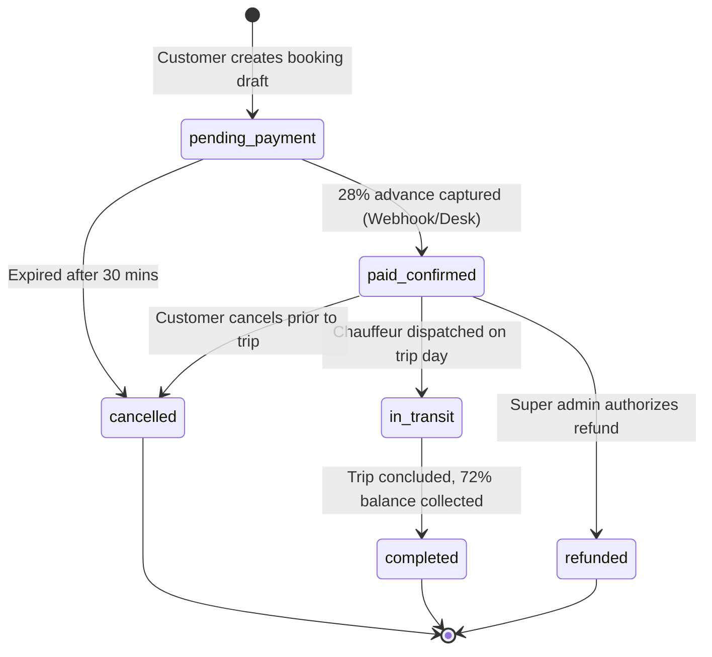
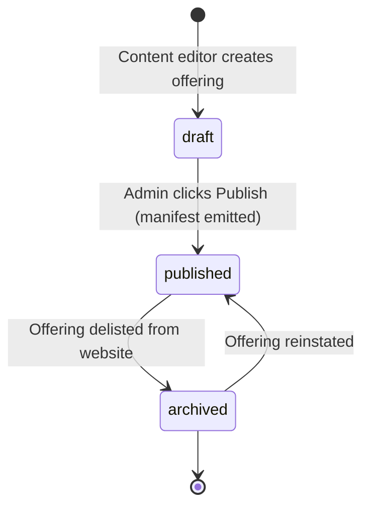
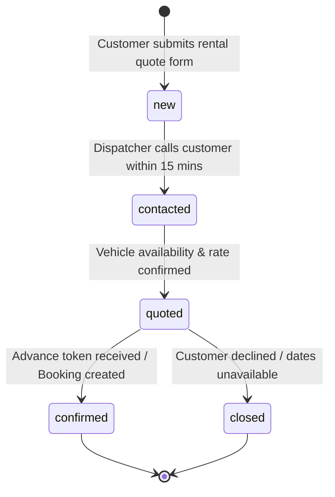

# Product Requirements Document (PRD) — Admin Panel

**Product:** Internal Operations Desk & Administration Platform for **Agra SK Baghel Tour & Travels**  
**Document Version:** 2.0 — Authoritative Complete System Specification  
**Status:** Implemented & Verified in Production Monorepo  
**Project:** `tarun1sisodia/ArenaAI` (`admin/`)  
**Deployment Target:** Cloudflare Pages (`skbagheltravels-admin`)  
**Related Documents:** [ADMIN_SCOPE_BOUNDARY.md](ADMIN_SCOPE_BOUNDARY.md), [ADMIN_TRD.md](ADMIN_TRD.md), [ADMIN_API_CONTRACT.md](ADMIN_API_CONTRACT.md), [ADMIN_MODELS.md](ADMIN_MODELS.md), [ADMIN_CONTROLLERS.md](ADMIN_CONTROLLERS.md), [BACKEND_RULES.md](../../BACKEND_RULES.md), [contracts/fare-system.ts](../../contracts/fare-system.ts), [contracts/catalog.ts](../../contracts/catalog.ts)

---

## 1. Executive Summary & Vision

**Agra SK Baghel Tour & Travels** is a premier tour, outstation taxi, and sightseeing service operating across Agra, Mathura, Vrindavan, Delhi NCR, and the Golden Triangle corridors.

The **Admin Panel** (`admin/`) serves as the internal operations desk for travel dispatchers, tour coordinators, finance operators, review moderators, and desk managers. It is designed to run day-to-day operations with zero developer dependency and zero runtime ambiguity.

### Key Capabilities Delivered:
1. **Booking Operations & Fulfillment**: Complete lifecycle tracking (`pending_payment` ➔ `paid_confirmed` ➔ `in_transit` ➔ `completed` / `cancelled`), optimistic concurrency control, unmasked customer PII inspection, and manual payment confirmations.
2. **4 Canonical Fleet Groups & Model Specifications**: Real-time management of canonical vehicle groups (`sedan`, `suv`, `luxury`, `tempo_traveller`) and 24 vehicle models with seats, luggage capacity, and base per-km rates.
3. **Fare Engine, Rates & Commercial Exceptions**: Centralized configuration of commercial fare rules (versioned e.g. `2026-09-13`), night travel allowances, driver allowances, 250km/300km daily distance floors, and strict commercial rules for Force Urbania and Tempo Traveller (forced round-trip billing and 300km/day floor).
4. **Curated Product Catalog CMS**: Multi-category publishing covering:
   - **Outstation Corridors**: 980+ point-to-point and intercity routes with toll inclusion toggles.
   - **Local Sightseeing Packages**: 4h/40km, 8h/80km, and 12h/120km charters.
   - **Station & Airport Transfers**: Fixed-rate transfers for Agra Cantt (AGC), Agra Fort, Delhi IGI, and Jewar Airport.
   - **Tour Packages**: Multi-day excursions with day-by-day itineraries, inclusions, exclusions, and image galleries.
5. **Review Invitation & WhatsApp QR Studio**: Customer review moderation queue coupled with an interactive tool for dispatchers to generate review links, send 1-click WhatsApp invitations, and render/download high-resolution scannable QR codes for driver clipboards.
6. **Lead Management**: Call-first taxi rental enquiries from `/en/taxis/rent/` and general contact form leads with operator follow-up workflows.
7. **Finance Reconciliation & Idempotent Refunds**: Captured advance deposit ledger (28% lock-in token), chauffeur cash balance collection tracking (72%), and idempotent refund execution with mandatory audit reasons.
8. **Operational Sign-Off & Trip Readiness**: Pre-trip vehicle sanitation, permit verification, and driver readiness checklists.
9. **One-Click Live Publishing**: Manifest synchronization triggering real-time catalog emission to customer site and Cloudflare edge caches.
10. **Enterprise Security & Immutable Audit**: Supabase authentication, session auto-refresh, role-based access control (RBAC), and append-only audit logging for all mutations and PII access.

> [!IMPORTANT]
> **Boutique Travel Desk Operational Model**: Per client mandate, the platform functions as an authentic private tour and travel desk, **NOT** an on-demand ride-hailing marketplace (like Uber or Ola). The software manages pricing, bookings, catalog offerings, payments, and reviews. Physical vehicle registration tracking, driver employment rosters, and live GPS telemetry dispatching are intentionally out of scope.

---

## 2. System Architecture & Monorepo Integration

The Admin Panel is a single-page application (SPA) built with React 19, TypeScript, Vite, Tailwind CSS, Motion, and Lucide icons. It communicates with the Fastify backend via a strongly typed API client (`admin/src/lib/cleanAdminApi.ts`) governed by canonical monorepo contracts.

```
┌────────────────────────────────────────────────────────────────────────┐
│                        ADMIN DESK SPA (admin/)                         │
│  React 19 • Vite • Tailwind • Motion • Lucide • Supabase Auth Client   │
└────────────────────────────────────┬───────────────────────────────────┘
                                     │ Authoritative REST & Bearer JWT
                                     ▼
┌────────────────────────────────────────────────────────────────────────┐
│                      FASTIFY BACKEND (backend/)                        │
│   Auth Guard • RBAC Middleware • Fare Engine • Idempotent Refunds      │
└───────────────────┬────────────────────────────────┬───────────────────┘
                    │                                │
                    ▼                                ▼
┌───────────────────────────────────┐    ┌───────────────────────────────┐
│     PostgreSQL (Supabase)         │    │       External Gateways       │
│  Bookings • Catalog • Fare Rules  │    │  Razorpay / PayPal APIs       │
│  Reviews • Leads • Audit Logs     │    │  (Signed Webhooks & Refunds)  │
└───────────────────────────────────┘    └───────────────────────────────┘
```

---

## 3. User Roles & Permission Matrix (RBAC)

The system enforces granular Role-Based Access Control via database profiles and JWT claims:

| Module / Action | `dispatcher` | `content_editor` | `review_moderator` | `finance_operator` | `super_admin` |
|---|:---:|:---:|:---:|:---:|:---:|
| **Dashboard Metrics & Analytics** | ✅ | ✅ | ✅ | ✅ | ✅ |
| **Search & Filter Bookings** | ✅ | ❌ | ❌ | ✅ | ✅ |
| **Inspect Booking Details** | ✅ | ❌ | ❌ | ✅ | ✅ |
| **Unmask Customer PII (Phone/Email)** | ✅ | ❌ | ❌ | ❌ | ✅ |
| **Advance Booking Status (`in_transit`, `completed`)** | ✅ | ❌ | ❌ | ❌ | ✅ |
| **Manual Payment Marking (Offline Advance)** | ✅ | ❌ | ❌ | ✅ | ✅ |
| **Trigger Payment Refund** | ❌ | ❌ | ❌ | ❌ | ✅ |
| **Manage Fleet Models & Canonical Groups** | ❌ | ❌ | ❌ | ❌ | ✅ |
| **Edit Fare Settings & Commercial Rates** | ❌ | ❌ | ❌ | ❌ | ✅ |
| **Edit Routes & Corridor Fares** | ❌ | ✅ | ❌ | ❌ | ✅ |
| **Manage Tour Packages & Itineraries** | ❌ | ✅ | ❌ | ❌ | ✅ |
| **Manage Local Sightseeing & Transfers** | ❌ | ✅ | ❌ | ❌ | ✅ |
| **Moderate Reviews (Approve/Reject)** | ❌ | ❌ | ✅ | ❌ | ✅ |
| **Review Invitation & WhatsApp QR Studio** | ✅ | ❌ | ✅ | ❌ | ✅ |
| **Manage Rental Requests & Leads** | ✅ | ❌ | ❌ | ❌ | ✅ |
| **Publish Catalog to Customer Site** | ❌ | ❌ | ❌ | ❌ | ✅ |
| **Execute Operational Sign-Off** | ✅ | ❌ | ❌ | ❌ | ✅ |
| **Manage Policies & Terms** | ❌ | ✅ | ❌ | ❌ | ✅ |
| **Inspect System Audit Logs** | ❌ | ❌ | ❌ | ❌ | ✅ |

---

## 4. Comprehensive Functional Specifications (All 18 Modules)

### 4.1. Authentication & Session Security (`/login`, `/auth/callback`)
- **Authentication Methods**: Secure email and password authentication with Supabase Auth, with support for Magic Links and OAuth redirects.
- **Session Lifecycle**: Access tokens stored in encrypted browser session storage with automatic proactive refresh before expiry.
- **Auto-Logout & Security Guard**: Emits `AUTH_EXPIRED_EVENT` on 401 Unauthorized or invalid session, clearing sensitive in-memory state and redirecting to login.
- **Strict Role Verification**: Route guards verify user role before mounting lazy-loaded administrative modules.

### 4.2. Operations Dashboard (`/`)
- **Real-Time KPIs**:
  - Total active bookings count.
  - Today's confirmed departures.
  - Financial overview (captured 28% online advances vs pending chauffeur 72% collections).
  - Pending customer reviews awaiting moderation.
  - Uncontacted rental requests and custom tour inquiries.
- **Operational Shortcuts**: Quick navigation to create bookings, review drafts, add tour packages, and inspect live audit trails.
- **Activity Feed**: Real-time chronological audit snapshot of recent status updates, payments, and staff logins.

### 4.3. Bookings Operations Desk (`/bookings`)
- **Fast Search & Lookup**: Instant search by Ticket ID (`AGR-YYYYMMDD-XXXX`), customer phone number, customer email, or booking UUID.
- **Filter Facets**:
  - **Status**: `pending_payment`, `paid_confirmed`, `in_transit`, `completed`, `cancelled`, `refunded`.
  - **Category**: `outstation`, `local_package`, `transfer`, `tour_package`.
  - **Fleet Group**: `sedan`, `suv`, `luxury`, `tempo_traveller`.
  - **Date Ranges**: Pickup date, travel completion date, and booking creation date.
- **Inspection Drawer**:
  - Route summary (origin, destination, pickup address, drop address, scheduled date/time, estimated distance in km, travel duration).
  - Server-calculated immutable fare snapshot (base fare, night allowance, driver allowance, tolls/taxes included, promo discounts, total fare, advance paid, balance payable to driver).
  - Selected vehicle model specifications and passenger count.
- **Privacy & PII Protection**:
  - Customer phone and email are masked by default (`+91 98*** **598`).
  - Authorized dispatchers can click **Unmask PII**, which logs an immutable audit event (`UNMASK_CUSTOMER_PII`) with user ID and timestamp.
- **Optimistic Concurrency Control**:
  - Status updates require sending the current `version` integer (`expectedVersion`).
  - Prevents race conditions and overwrites when multiple dispatchers view the same booking simultaneously.
- **Manual Payment Confirmation**:
  - Ability for authorized staff to record offline advance payments (bank NEFT/IMPS or cash received at Taj Ganj desk), with reference number logging.

### 4.4. Canonical Vehicles & Fleet Showroom (`/vehicles`)
- **4 Canonical Fleet Groups Only**:
  - `sedan`: 4 passengers, 2 bags (Maruti Dzire AC, Honda City, Maruti Ciaz).
  - `suv`: 6–7 passengers, 3–4 bags (Maruti Ertiga, Toyota Innova Crysta, Toyota Fortuner).
  - `luxury`: 4–6 passengers, 3–4 bags (Toyota Camry, Toyota Vellfire, Mercedes E-Class, BMW 5-Series).
  - `tempo_traveller`: 10–17 passengers, 8–12 bags (Force Traveller 12-seater, Force Traveller 17-seater, Force Urbania 13-seater).
- **Vehicle Model Configuration**:
  - Create and edit vehicle models with make, model name, display name, passenger capacity, luggage capacity, default per-km benchmark, and asset image URL.
  - Active/inactive availability toggling for customer showroom display.

### 4.5. Fare Settings & Commercial Rules (`/fares/settings`)
- **Rules Versioning**: Authoritative fare versioning (e.g. `2026-09-13`), ensuring all active bookings freeze their calculation version.
- **Base Pricing Parameters**:
  - Minimum daily distance floor (250 km/day for standard outstation; 300 km/day for commercial exceptions).
  - Night travel surcharge rate and active hours (10:00 PM – 06:00 AM).
  - Standard driver daily allowance (₹400/day for Sedan, ₹500/day for SUV, ₹700/day for Luxury, ₹800/day for Tempo).
  - Round-trip night halt allowance.
- **Commercial Exception Rules (Force Urbania & Tempo Traveller)**:
  - Enforced round-trip distance doubling (`km * 2`).
  - Strict 300 km/day minimum floor (`Math.max(km * 2, 300 * days)`).
  - Mandatory ₹500/day driver allowance and locked rate structure (immune to promotional coupon discounts).

### 4.6. Round-Trip Pricing Matrix (`/fares/rates`)
- Multi-day outstation rate-per-kilometer configuration across all canonical groups.
- Halt per night charges and multi-city itinerary calculation rules.

### 4.7. Extra Charges & Surcharges (`/fares/extra-charges`)
- **Interstate Border Taxes**: State passenger transport permit costs for Uttar Pradesh, Delhi NCR, Haryana, and Rajasthan.
- **Expressway Toll Policies**: Inclusion rules for Yamuna Expressway, Eastern Peripheral Expressway, Agra-Lucknow Expressway, and Delhi-Mumbai Expressway.
- **Peak Season / Festival Surcharges**: Configurable date-bounded multipliers for Diwali, New Year, and peak tourist season.

### 4.8. Routes Directory CMS (`/routes`)
- **980+ Corridors**: High-throughput outstation route management.
- **Parameters**: Origin, destination, distance in km, estimated travel duration, corridor tag (e.g. *Direct Highway Corridor*, *Yamuna Expressway Corridor*), toll inclusion flag.
- **Tiered Pricing**: Per-route fixed rates across vehicle groups.
- **Search & Filter**: Instant search by city pair, highway corridor, and publication state.

### 4.9. Unified Catalog Explorer (`/catalog`)
- Unified single-pane inventory of all customer-facing offerings across Outstation, Local Packages, Transfers, and Tour Packages.
- Status badges (`draft`, `published`, `archived`), starting prices, and quick edit links.

### 4.10. Tour Packages CMS (`/tour-packages`)
- **Multi-Day & Day Tour Management**: Creation, editing, and scheduling of curated tour packages (e.g., Same Day Agra Taj Mahal Tour, Sunrise Taj Mahal Tour, Golden Triangle Tour, Mathura-Vrindavan Pilgrimage).
- **Rich Itinerary Builder**: Day-by-day timeline, monument highlights, stops covered, and curated descriptions.
- **Starting Price & Vehicle Pricing Grid**: Configurable fixed starting fare and vehicle-specific package tariffs (Sedan, Ertiga, Innova, Tempo, Urbania).
- **Inclusions & Exclusions**: Clear contractual bullet points (tolls included, chauffeur allowance included, monument entry tickets excluded).
- **Gallery Manager**: Drag-and-drop cover photo assignment, gallery order, captions, and alt text.

### 4.11. Local Sightseeing & Transfers CMS (`/local-transfers`)
- **Local Hourly Sightseeing**: Fixed packages (4 Hours / 40 KM, 8 Hours / 80 KM, 12 Hours / 120 KM) with monument coverage lists.
- **Fixed-Rate Station Drops**: Agra Cantt (AGC) and Agra Fort railway station transfers with platform greeting notes.
- **Airport Charters**: Delhi IGI Airport (T1/T3), Jewar International Airport, and Kheria Airport transfers.
- **Fixed Fleet Rates**: Group-specific tariffs guaranteeing transparent fixed billing without meter tampering.

### 4.12. Customer Review Moderation & WhatsApp QR Studio (`/reviews`)
- **Moderation Queue**: Incoming customer reviews with 1–5 star ratings, customer feedback, and photo attachments.
- **Trip Verification**: Cross-reference submitted review with customer Ticket ID, assigning authentic `Verified Customer` badges.
- **Moderation Actions**: Approve, reject, publish to live website, or archive.
- **Review Invitation & WhatsApp QR Studio**:
  - Dedicated tool atop the Reviews Desk for dispatchers to collect authentic verified reviews.
  - Form fields: Customer Name, Booking Ticket ID, Chauffeur Name, Tour Name.
  - Live review submission URL generated with pre-filled verification tokens.
  - **1-Click WhatsApp Share**: Formats personalized message (`"Hello [Name], thank you for traveling with Agra SK Baghel Tour & Travels! Please share your experience here: [URL]"`).
  - **Live Dynamic QR Code**: Real-time canvas rendering of a crisp, high-resolution QR code using `qrcode`.
  - **1-Click PNG Download**: Exports printable QR image for vehicle glove compartments and driver trip clipboards.

### 4.13. Call-First Taxi Rental Requests (`/rental-requests`)
- **Dedicated Rental Funnel**: Captures call-first rental inquiries submitted from `/en/taxis/rent/`.
- **Inquiry Details**: Customer name, phone number, email, selected vehicle group, specific preferred model, pickup date, return date, pickup location in Agra, itinerary destination, passenger count, and verified chauffeur toggle.
- **Workflow State Machine**: `new` ➔ `contacted` ➔ `quoted` ➔ `confirmed` ➔ `closed`.
- **Operational Notes**: Chauffeur assignment notes and negotiated custom rates recorded in real-time.

### 4.14. Customer Inquiries & Leads Desk (`/inquiries`)
- Inbox for inquiries originating from contact forms and marketing landing pages.
- Status tracking, operator assignment, notes log, and conversion tracking.

### 4.15. Finance & Payment Reconciliation (`/finance`)
- **Payment Gateway Ledger**: Audits captured online advance payments from Razorpay, PayPal, and international card processors.
- **Transaction Snapshot**: Payment Gateway Reference ID, Order ID, payment method (UPI, Netbanking, Credit/Debit Card), net amount captured, and capture timestamp.
- **Chauffeur Cash Collection Audit**: Tracks the remaining 72% trip balance due upon completion directly to the chauffeur.
- **Idempotent Refund Subsystem**:
  - Super Admin and Finance Operators can initiate partial or full refunds against eligible bookings.
  - Requires mandatory refund reason documentation and a unique client-generated idempotency key (`idempotencyKey`).
  - Prevents double-refund execution during network retries.
  - Triggers payment gateway refund API and synchronously transitions payment and booking states to `refunded`.

### 4.16. Operational Sign-Off Desk (`/sign-off`)
- Digital pre-departure inspection checklist for dispatchers:
  - Vehicle deep sanitation and AC cooling check.
  - Driver commercial license, badge, and police verification verification.
  - FASTag highway wallet balance check.
  - Mineral water bottles, umbrellas, and passenger emergency kit verification.
- Digital sign-off records permanently bound to booking tickets.

### 4.17. Customer Policies CMS (`/policies`)
- Single source of truth for terms and conditions displayed across the customer portal:
  - 28% advance deposit policy and 72% chauffeur balance policy.
  - 24-hour free cancellation policy and refund timelines.
  - Luggage allowances per vehicle group.
  - Interstate border passenger tax and night travel guidelines.

### 4.18. Immutable Audit Trail (`/audit`)
- Append-only security ledger logging all administrative operations:
  - Event types: `BOOKING_STATUS_CHANGE`, `UNMASK_CUSTOMER_PII`, `PAYMENT_REFUND_EXECUTED`, `FARE_RULE_MUTATION`, `CATALOG_PUBLISHED`, `USER_LOGIN`.
  - Log metadata: UTC Timestamp, Actor UUID, User Role, Resource Type, Resource UUID, Client IP Address, User-Agent, and detailed JSON diff payload.
  - Guaranteed tamper-proof (no deletion or modification allowed via API or UI).

---

## 5. Canonical Data Contracts & State Machines

### 5.1. Booking Lifecycle State Machine


### 5.2. Catalog Item State Machine


### 5.3. Rental Enquiry State Machine


---

## 6. Technical Stack & Implementation Details

- **Frontend Core**: React 19, TypeScript 5.8, Vite 7.3.
- **Routing**: `react-router-dom` v7 with code-split lazy routes (`React.lazy`, `Suspense`).
- **Styling**: Tailwind CSS with custom editorial design tokens matching the luxury customer theme (`font-serif`, `terracotta`, `ink-charcoal`, `sandstone-wash`).
- **Icons & Motion**: `lucide-react`, `motion/react` (with accessibility-conscious `useReducedMotion`).
- **QR Engine**: `qrcode` canvas rendering for dynamic high-density scannable review codes.
- **Contract Synchronization**: Canonical types imported from `contracts/fare-system.ts` and `contracts/catalog.ts`, synchronized across monorepo apps with `npm run contracts:sync` and validated by `contracts:check`.

---

## 7. Operational Safety & Non-Functional Requirements

1. **Performance**: All administrative search queries, filters, and dashboard metrics resolve in `< 500ms` against PostgreSQL indexes.
2. **Optimistic Locking**: Every mutation against bookings, fleet, and pricing verifies `expectedVersion` to prevent concurrent overwrite collisions.
3. **Data Protection & PII**: Customer contact details are masked by default. Unmasking events are logged with actor identity, IP, and timestamp.
4. **Zero Live Developer Dependencies**: The operations desk can modify fares, add vehicle models, create tour packages, and publish catalog offerings completely autonomously without requiring code changes, pull requests, or redeployments.
5. **Idempotent Financial Safety**: Refund executions require unique idempotency keys, preventing double payouts under transient network failures.
6. **Strict Monorepo Build Hygiene**: All changes must pass `npm run verify` (typechecks across all 3 applications, 300+ backend automated tests, 40 customer tests, and clean production builds).
