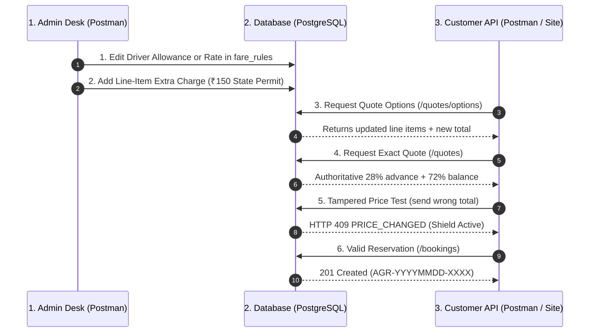

# Complete Manual & Postman API Testing Guide

> **Target:** SK Baghel Tour & Travels Monorepo (`backend/`, `admin/`, `react/`)  
> **Server Base URL:** `http://localhost:4000`  
> **Postman Collection Path:** `postman/SK_Baghel_Tour_and_Travels_Fare_System.postman_collection.json`  
> **Postman Environment Path:** `postman/Local_Development.postman_environment.json`  

---

## 1. Quick Start: Booting the System

Before executing tests, ensure your local Fastify backend is running:

```powershell
# From repository root:
npm run dev:backend
```

Or to run backend, customer site, and admin desk together:
```powershell
npm run dev:all
```

*Note: In `backend/.env`, `ALLOW_TEST_AUTH=true` is now enabled for local development. This permits the header `Authorization: Bearer test-super_admin` without requiring an external OAuth login ceremony.*

---

## 2. Importing into Postman (1-Click Setup)

1. Open **Postman**.
2. Click **Import** (top left).
3. Select the two files located in this repository:
   - `postman/SK_Baghel_Tour_and_Travels_Fare_System.postman_collection.json`
   - `postman/Local_Development.postman_environment.json`
4. In Postman, switch the active environment dropdown (top right) to **"Local Development (ArenaAI)"**.
5. All variables (`baseUrl`, `adminToken`, `routeId`, `sedanModelId`, etc.) are pre-configured.

---

## 3. Systematic Testing Sequence (The 100% Confidence Plan)

Follow this order to seed/edit as Admin, then immediately verify the dynamic calculations as Customer.



---

## 4. Phase-by-Phase cURL Commands

### Phase A: Admin CRUD — Fleet & Vehicle Groups

#### A1. List Vehicle Groups
```bash
curl -X GET http://localhost:4000/api/v1/admin/fares/vehicle-groups \
  -H "Authorization: Bearer test-super_admin"
```
*Expected: 200 OK with 4 groups (`sedan`, `suv`, `luxury`, `tempo_traveller`) and their DA/halt charges.*

#### A2. Update Sedan Driver Allowance & Night Charge
```bash
curl -X PATCH http://localhost:4000/api/v1/admin/fares/vehicle-groups/10000000-0000-0000-0001-000000000001 \
  -H "Authorization: Bearer test-super_admin" \
  -H "Content-Type: application/json" \
  -d '{
    "driver_allowance_per_day": 550,
    "one_way_night_charge": 250,
    "round_trip_halt_per_night": 300
  }'
```
*Expected: 200 OK. Records a before/after audit diff in `admin_audit_logs`.*

#### A3. Create a New Vehicle Model
```bash
curl -X POST http://localhost:4000/api/v1/admin/fares/vehicle-models \
  -H "Authorization: Bearer test-super_admin" \
  -H "Content-Type: application/json" \
  -d '{
    "vehicle_group_id": "10000000-0000-0000-0001-000000000001",
    "make": "Maruti",
    "model_name": "Ciaz",
    "display_name": "Maruti Ciaz (Executive Sedan)",
    "passenger_capacity": 4,
    "luggage_capacity": 3,
    "sort_order": 15,
    "is_active": true
  }'
```
*Expected: 201 Created with the new vehicle model UUID.*

---

### Phase B: Admin CRUD — Commercial Settings & Route Pricing

#### B1. Verify Global Settings (Requirement B: max_round_trip_days = 5)
```bash
curl -X GET http://localhost:4000/api/v1/admin/fares/settings \
  -H "Authorization: Bearer test-super_admin"
```
*Expected: 200 OK containing `advance_percent: 28`, `max_round_trip_days: 5`, `min_km_per_day: 300`.*

#### B2. Interactive Distance Calculation (LocationIQ)
```bash
curl -X POST http://localhost:4000/api/v1/admin/routes/calculate-distance \
  -H "Authorization: Bearer test-super_admin" \
  -H "Content-Type: application/json" \
  -d '{
    "origin_name": "Agra, Uttar Pradesh",
    "destination_name": "New Delhi, Delhi"
  }'
```
*Expected: 200 OK with `distance_km` (e.g. `230.0`) and `duration_minutes` (`240`). Does not persist until saved.*

#### B3. Set Flat Prices for Vehicles on Agra->Delhi Route
```bash
curl -X PUT http://localhost:4000/api/v1/admin/routes/20000000-0000-0000-0001-000000000001/vehicles \
  -H "Authorization: Bearer test-super_admin" \
  -H "Content-Type: application/json" \
  -d '{
    "vehicles": [
      {
        "vehicle_model_id": "10000000-0000-0000-0002-000000000001",
        "one_way_amount": 2500,
        "round_trip_enabled": true,
        "inclusions": ["Toll Tax", "State Permit"],
        "exclusions": ["Parking Charges"]
      },
      {
        "vehicle_model_id": "10000000-0000-0000-0002-000000000004",
        "one_way_amount": 4500,
        "round_trip_enabled": true,
        "inclusions": ["Toll Tax", "State Permit", "Driver Allowance"],
        "exclusions": ["Parking Charges"]
      }
    ]
  }'
```
*Expected: 200 OK with `{ "success": true }`.*

#### B4. Add Extra Charge (Delhi Entry Permit)
```bash
curl -X POST http://localhost:4000/api/v1/admin/fares/extra-charges \
  -H "Authorization: Bearer test-super_admin" \
  -H "Content-Type: application/json" \
  -d '{
    "category": "outstation",
    "label": "Delhi State Entry Permit",
    "amount": 150,
    "is_active": true
  }'
```
*Expected: 201 Created with new extra charge ID.*

---

### Phase C: Customer API Testing — Live Fare Calculations

#### C1. Fetch Published Product Details
```bash
curl -X GET http://localhost:4000/api/v1/catalog/outstation/agra-to-delhi
```
*Expected: 200 OK with product name, distance, starting fare, and inclusions/exclusions.*

#### C2. Reactive Quote Options (One-Way)
```bash
curl -X POST http://localhost:4000/api/v1/quotes/options \
  -H "Content-Type: application/json" \
  -d '{
    "category": "outstation",
    "route_id": "20000000-0000-0000-0001-000000000001",
    "trip_type": "one_way",
    "passenger_count": 2,
    "pickup_at": "2026-10-15T09:00:00+05:30"
  }'
```
*Expected: 200 OK with cars grouped by Sedan, SUV, Luxury, Tempo. Notice Maruti Dzire displays `base_amount: 2500`, extra charges `[{"label": "Delhi State Entry Permit", "amount": 150}]`, and total `2650`.*

#### C3. Reactive Quote Options (Round-Trip 3 Days IST)
```bash
curl -X POST http://localhost:4000/api/v1/quotes/options \
  -H "Content-Type: application/json" \
  -d '{
    "category": "outstation",
    "route_id": "20000000-0000-0000-0001-000000000001",
    "trip_type": "round_trip",
    "passenger_count": 5,
    "pickup_at": "2026-10-15T09:00:00+05:30",
    "return_at": "2026-10-17T20:00:00+05:30"
  }'
```
*Expected: 200 OK. Computes `date(2026-10-17) - date(2026-10-15) + 1` = 3 days. Multiplies $3 \times 300\text{ km} = 900\text{ km}$ minimum billing at per-km rate + 3 days driver allowance.*

#### C4. Authoritative Binding Quote
```bash
curl -X POST http://localhost:4000/api/v1/quotes \
  -H "Content-Type: application/json" \
  -d '{
    "category": "outstation",
    "route_id": "20000000-0000-0000-0001-000000000001",
    "vehicle_model_id": "10000000-0000-0000-0002-000000000001",
    "trip_type": "one_way",
    "passenger_count": 2,
    "pickup_at": "2026-10-15T09:00:00+05:30"
  }'
```
*Expected: 200 OK. Exact calculation breakdown with `advance_amount` (28%) and `balance_amount` (72%).*

---

### Phase D: Concurrency Shield & Booking Verification

#### D1. Negative Test: Tampered Price Submission
```bash
curl -X POST http://localhost:4000/api/v1/bookings \
  -H "Content-Type: application/json" \
  -d '{
    "quote": {
      "category": "outstation",
      "route_id": "20000000-0000-0000-0001-000000000001",
      "vehicle_model_id": "10000000-0000-0000-0002-000000000001",
      "trip_type": "one_way",
      "passenger_count": 2,
      "pickup_at": "2026-10-15T09:00:00+05:30"
    },
    "quoted_total": 999,
    "customer_name": "Tampered Customer",
    "customer_phone": "+919876543210",
    "customer_email": "test@example.com",
    "pickup_address": "Agra Cantt",
    "drop_address": "Delhi Airport"
  }'
```
*Expected: **HTTP 409 Conflict** with `{ "error": "PRICE_CHANGED", "message": "The fare has changed. Please confirm the updated quote.", "fresh_quote": { ... } }`.*

#### D2. Positive Test: Valid Reservation Creation
```bash
curl -X POST http://localhost:4000/api/v1/bookings \
  -H "Content-Type: application/json" \
  -d '{
    "quote": {
      "category": "outstation",
      "route_id": "20000000-0000-0000-0001-000000000001",
      "vehicle_model_id": "10000000-0000-0000-0002-000000000001",
      "trip_type": "one_way",
      "passenger_count": 2,
      "pickup_at": "2026-10-15T09:00:00+05:30"
    },
    "quoted_total": 2650,
    "customer_name": "Tarun Sisodia",
    "customer_phone": "+919876543210",
    "customer_email": "tarun@example.com",
    "pickup_address": "Tajganj, Agra",
    "drop_address": "Connaught Place, New Delhi"
  }'
```
*Expected: **HTTP 201 Created** with `{ "success": true, "booking": { "id": "...", "ticket_id": "AGR-20261015-...", "status": "pending", "advance_amount": 742, "balance_amount": 1908 } }`.*

---

## 5. Audit & Outbox Verification

```bash
# Verify the immutable audit log of your changes:
curl -X GET http://localhost:4000/api/v1/admin/audit-logs \
  -H "Authorization: Bearer test-super_admin"
```
*Expected: 200 OK returning the before-and-after snapshots of every table row touched.*
