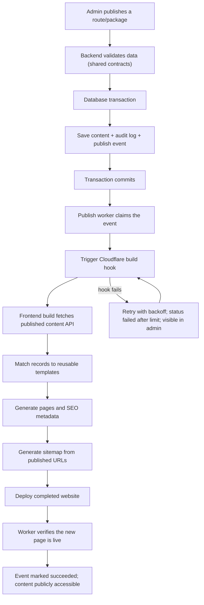

# SK Baghel Tour & Travels — Fare System: Final Specification

**This one document replaces `fare-system-spec-v3.md` and `client-changes-v4.md`.** Give only this file to the agent.
It is a clean rebuild: nothing from the old fare system, old tables, old enums or old backend code is carried over. The database holds test data only and is wiped.

Status: a plan. Nothing here is built yet, and the test numbers were worked out by hand from the formulas.

Contents: 0 Ready check · 1 Locked decisions · 2 Fare rules · 3 Database · 4 Price and availability lookup · 5 Routes and LocationIQ · 6 Contracts and APIs · 7 Booking and payment · 8 Customer frontend plan · 9 Admin plan · 10 Templates and publishing pipeline · 11 Reviews · 12 Tests · 13 Code layout and agent instructions

---

## 0. Ready check

**Ready to hand to the agent: yes.** Every rule below is decided. Numbers (prices, charges, percentages, limits) are **admin-editable database values**, so missing values never block the build.

Values the client still has to type into the admin panel (or give you for the seed):
- One-way night charge per group (sedan, SUV, luxury, tempo). Until set it is 0, meaning no night charge.
- Round-trip ₹/km for every car, and a one-way price for every car on every route.
- The cars the operator really offers (names, seats).

Assumptions I made from your last message. None blocks the build; each is one setting or one column, so a change later is a data edit:
| # | Assumption | If wrong |
|---|---|---|
| A1 | "Up to 2 days only" means a round trip online can span at most 2 calendar days (setting `max_round_trip_days` = 2); longer trips get a "please contact us" message | Change the setting |
| A2 | The future round-trip "night" charge is a **per-night halt charge**: price per night × number of nights (nights = days − 1). Column `round_trip_halt_per_night` per group, default 0 | Change the column meaning in one calculator line |
| A3 | Night window is the pickup time, 20:00 up to (not including) 06:00, stored as settings `night_start_hour` = 20 and `night_end_hour` = 6 | Change the settings |
| A4 | Prices entered by the admin are GST-inclusive; no tax line | Add a tax line later |
| A5 | Review links for bookings stay valid 30 days (a configuration value) | Change the config value |
| A6 | Review social accounts are the **customer's** (optional), which the admin may pre-fill | Small form change |

---

## 1. Locked decisions

1. Four pricing categories (a fixed list stored as a `category` text column with a CHECK, not a table):
   | `category` | Unit |
   |---|---|
   | `outstation` | one-way fixed price per route per car; round trip per km |
   | `local_package` | per package |
   | `transfer` | per trip |
   | `tour_package` | per package |
2. Four vehicle groups: `sedan`, `suv`, `luxury`, `tempo_traveller`. Each has many car models. **The customer chooses a specific car.** Every price belongs to one car model. There is no group-level fallback price.
3. **One-way outstation:** fixed price per route and per car, entered by the admin. No driver allowance, no distance maths, no minimum km. Only a pickup-time night charge.
4. **Round-trip outstation:** `max(2 × route km, 300 × days)` kilometres × the car's ₹/km, plus a driver allowance **per day on every round trip** (₹500 for sedan, SUV, luxury; ₹700 for Tempo Traveller). No pickup-time night charge. A per-night halt charge column exists for the future (default 0).
5. **Local packages:** "8 hours / 80 km" and "Full Day", fixed price per car. Extra km/hours are never charged by the system; the driver collects any extra in cash. **Transfers** and **tour packages:** fixed price per car.
6. Every category gets include / exclude lists and content fields like the tour package has. Outstation lists are **separate for one-way and round trip, per route and car**.
7. The customer sees only the cars the admin enabled for that route (or product), grouped by vehicle group. Empty groups are hidden. A car without a usable price is never shown, never as ₹0, never with another car's price.
8. Advance is **28% of the total**, always, from a global setting. Balance is the rest.
9. Explicit charges (toll, parking, interstate tax, any flat amount) and notes are admin data in `extra_charges`. A charge with an amount is added to the total as its own line; a row with no amount is a message only. Only what the admin adds exists.
10. Extra km beyond the booked distance: shown as policy text; the driver collects it (cash or online). The system calculates nothing for it.
11. **Nothing is hardcoded.** Rates, fixed prices, allowances, night charges, halt charges, advance percent, minimum km per day, maximum round-trip days, night-window hours: all in the database and editable by the admin. Code holds only formulas and rounding.
12. Only the backend computes fares. Frontends send selections and render the response. URL parameters are inputs, never prices.
13. Quotes are not stored. Booking creation recomputes and compares with the total the customer saw (409 `PRICE_CHANGED` if different).
14. Route distance and duration come from LocationIQ once, when the admin creates the route (Calculate button), and are stored. Quotes never call LocationIQ.
15. Money is whole integer rupees (INR). Payment amount in paise = rupees × 100. Rounding is half up.
16. Every admin write writes a row to `admin_audit_logs`.
17. Pickup must be in the future. Passenger count must not exceed the car's seats.
18. Prices update immediately (live API). Page content updates through the publishing pipeline (section 10).

---

## 2. Fare rules

Line order: base → driver allowance → halt → night → explicit charges. A line whose amount is 0 is omitted from the quote (the base fare line is always present).

### 2.1 One-way outstation
```
base_fare = outstation_route_vehicles.one_way_amount      (this route + this car, active)
night     = group.one_way_night_charge   if pickup local time (IST) is in the night window
extras    = sum of applicable extra_charges
total     = base_fare + night + extras
```
Night window: hour(pickup) ≥ `night_start_hour` or hour(pickup) < `night_end_hour` (defaults 20 and 6). 19:59 no, 20:00 yes, 05:59 yes, 06:00 no. Uses the pickup time, not the time of booking.

### 2.2 Round-trip outstation
```
d        = route.distance_km                            (one-way, stored)
days     = IST_date(return_at) − IST_date(pickup_at) + 1
nights   = days − 1
if days > max_round_trip_days: error TRIP_TOO_LONG
billable_km = max(2 × d, min_km_per_day × days)         (min_km_per_day default 300)
base_fare   = round_half_up(billable_km × car ₹/km)
allowance   = group.driver_allowance_per_day × days     (every round trip, same-day included)
halt        = group.round_trip_halt_per_night × nights  (0 until the client sets it)
extras      = sum of applicable extra_charges
total       = base_fare + allowance + halt + extras
```
No pickup-time night charge on round trips. Days are calendar days in Asia/Kolkata, never UTC.

### 2.3 Local package, transfer, tour package
```
total = the car's fixed amount for that product + sum of applicable extra_charges
```
No distance, allowance or night charge.

### 2.4 Applicable extra charges
A row applies when: `is_active`; same `category`; (product is empty or equals the quote's product); (vehicle group is empty or equals the car's group). Rows with an amount become `extra_charge` lines (flat: not per day, not per km). Rows without an amount go to `messages` and never change the total.
Toll and parking per item: **included** (listed in the inclusions), **pay the driver separately** (listed in the exclusions), or **fixed extra added to the quote** (an `extra_charges` row with an amount).

### 2.5 Advance and balance
```
advance = min(total, round_half_up(total × advance_percent / 100))      (advance_percent = 28)
balance = total − advance
```
Based on the final total including extra charges.

### 2.6 Discounts and tax
None in v1; prices are GST-inclusive. The finalizer keeps a slot for discounts so promotions can be added later without changing the quote shape.

---

## 3. Database (Supabase PostgreSQL)

Rules for the agent: build exactly this. No extra columns, tables or indexes. Primary keys are `uuid primary key default gen_random_uuid()`. Enable RLS on every new table with no anon/customer policies; the backend uses the service role and customers read through the API.

### 3.1 What happens to existing tables

| Existing | Action |
|---|---|
| `fare_rules` (old), `route_catalog`, `local_sightseeing_packages`, `transfer_routes`, `package_vehicle_upgrades`, `promo_codes`, `customer_booking_intents`, `refunds`, `raw_webhooks`, `payments`, `bookings`, `reviews` | **Drop** (replaced below, or out of scope) |
| `tour_packages` | **Drop and recreate** with the new columns |
| Enums `vehicle_tier_enum`, `trip_type_enum`, `booking_status_enum`, `payment_status_enum`, `payment_provider_enum` | **Drop** if nothing else depends on them |
| `catalog_items` | **Keep**, but drop its columns `starting_price_inr` and `distance_km`. (Recommended later: retire it if no page uses it, since content now lives in the product tables.) |
| `admin_audit_logs`, `profiles`, `catalog_item_media`, `company_profile`, `device_registrations`, `dossier_signoffs`, `inquiries`, `location_cache`, `monuments`, `notification_jobs`, `pet_taxi_policy`, `cancellation_policies`, `schema_migrations` | **Keep unchanged.** `notification_jobs.booking_id` and `device_registrations.booking_id` must be re-pointed to the new `bookings(id)` (drop old FK, add new). |
| `rental_enquiries` | Keep. It has its own old tier list; update separately later. |

### 3.2 Schema

```sql
-- ===== Vehicles =====
create table vehicle_groups (
  id uuid primary key default gen_random_uuid(),
  code text not null unique check (code in ('sedan','suv','luxury','tempo_traveller')),
  name text not null,
  driver_allowance_per_day int not null default 0 check (driver_allowance_per_day >= 0),   -- round trips
  one_way_night_charge int not null default 0 check (one_way_night_charge >= 0),
  round_trip_halt_per_night int not null default 0 check (round_trip_halt_per_night >= 0), -- future use; 0 = off
  sort_order int not null default 0,
  is_active boolean not null default true
);

create table vehicle_models (
  id uuid primary key default gen_random_uuid(),
  vehicle_group_id uuid not null references vehicle_groups(id),
  make text not null,
  model_name text not null,
  display_name text not null,
  passenger_capacity int not null check (passenger_capacity > 0),   -- passengers only, driver excluded
  luggage_capacity int check (luggage_capacity >= 0),
  image_url text,
  sort_order int not null default 0,
  is_active boolean not null default true
);

-- ===== Global numbers (admin edits values; keys are fixed) =====
create table fare_settings (
  key text primary key check (key in ('advance_percent','min_km_per_day','max_round_trip_days','night_start_hour','night_end_hour')),
  value int not null,
  check (
    (key = 'advance_percent' and value between 1 and 100) or
    (key in ('min_km_per_day','max_round_trip_days') and value > 0) or
    (key in ('night_start_hour','night_end_hour') and value between 0 and 23)
  )
);

-- ===== Products. Bookable and visible as a page only when status = 'published'. =====
-- Content block used by all four: description, inclusions_highlight, inclusions_note, image_url, gallery, inclusions, exclusions.
create table outstation_routes (
  id uuid primary key default gen_random_uuid(),
  code text not null unique check (code ~ '^[a-z0-9-]{2,80}$'),     -- also the page slug
  origin_name text not null,
  destination_name text not null,
  distance_km numeric(7,1) check (distance_km > 0),                 -- one-way road km, from LocationIQ, editable
  duration_minutes int check (duration_minutes > 0),                -- informational, never in the fare
  description text,
  image_url text,
  gallery jsonb not null default '[]',
  status text not null default 'draft' check (status in ('draft','published','archived')),
  created_at timestamptz not null default now(),
  unique (origin_name, destination_name),
  check (status <> 'published' or (distance_km is not null and duration_minutes is not null))
);

create table local_packages (
  id uuid primary key default gen_random_uuid(),
  code text not null unique check (code ~ '^[a-z0-9-]{2,80}$'),
  name text not null,                              -- '8 hours / 80 km', 'Full Day'
  duration_hours int check (duration_hours > 0),   -- informational only
  included_km int check (included_km > 0),         -- informational only
  covers text,
  description text,
  inclusions_highlight text,
  inclusions_note text,
  image_url text,
  gallery jsonb not null default '[]',
  inclusions jsonb not null default '[]',
  exclusions jsonb not null default '[]',
  status text not null default 'draft' check (status in ('draft','published','archived')),
  created_at timestamptz not null default now()
);

create table transfers (
  id uuid primary key default gen_random_uuid(),
  code text not null unique check (code ~ '^[a-z0-9-]{2,80}$'),
  name text not null,
  pickup_name text not null,
  drop_name text not null,
  description text,
  inclusions_highlight text,
  inclusions_note text,
  image_url text,
  gallery jsonb not null default '[]',
  inclusions jsonb not null default '[]',
  exclusions jsonb not null default '[]',
  status text not null default 'draft' check (status in ('draft','published','archived')),
  created_at timestamptz not null default now()
);

create table tour_packages (
  id uuid primary key default gen_random_uuid(),
  code text not null unique check (code ~ '^[a-z0-9-]{2,80}$'),
  name text not null,
  duration_text text not null,
  days int not null default 1,
  nights int not null default 0,
  source text not null default 'Agra',
  destination text not null default '',
  description text,
  inclusions_highlight text,
  inclusions_note text,
  image_url text,
  gallery jsonb not null default '[]',
  inclusions jsonb not null default '[]',
  exclusions jsonb not null default '[]',
  itinerary jsonb not null default '[]',
  status text not null default 'draft' check (status in ('draft','published','archived')),
  created_at timestamptz not null default now()
);
-- days, nights and content columns are display content, never used in the fare.

-- ===== Outstation: which cars a route offers, one-way price, include/exclude per trip type =====
create table outstation_route_vehicles (
  id uuid primary key default gen_random_uuid(),
  route_id uuid not null references outstation_routes(id),
  vehicle_model_id uuid not null references vehicle_models(id),
  one_way_amount int check (one_way_amount > 0),          -- NULL = one-way not offered for this car
  round_trip_enabled boolean not null default true,
  terms jsonb not null default '{}',                      -- { one_way:{inclusions,exclusions}, round_trip:{inclusions,exclusions} } (contract)
  sort_order int not null default 0,
  is_active boolean not null default true,
  unique (route_id, vehicle_model_id),
  check (one_way_amount is not null or round_trip_enabled)
);

-- ===== Prices per car =====
-- outstation: all product ids NULL = the car's round-trip ₹/km (global, applies to every route)
-- local_package / transfer / tour_package: exactly its own product id = fixed ₹ for that car and product
create table fare_rules (
  id uuid primary key default gen_random_uuid(),
  category text not null check (category in ('outstation','local_package','transfer','tour_package')),
  vehicle_model_id uuid not null references vehicle_models(id),
  local_package_id uuid references local_packages(id),
  transfer_id uuid references transfers(id),
  tour_package_id uuid references tour_packages(id),
  amount int not null check (amount > 0),
  is_active boolean not null default true,
  check (
    (category = 'outstation'    and local_package_id is null and transfer_id is null and tour_package_id is null) or
    (category = 'local_package' and local_package_id is not null and transfer_id is null and tour_package_id is null) or
    (category = 'transfer'      and transfer_id is not null and local_package_id is null and tour_package_id is null) or
    (category = 'tour_package'  and tour_package_id is not null and local_package_id is null and transfer_id is null)
  )
);
create unique index fare_rules_one_active
  on fare_rules (category, vehicle_model_id, local_package_id, transfer_id, tour_package_id)
  nulls not distinct where is_active;

-- ===== Explicit charges and notes (admin-managed) =====
-- amount NULL = message only (label is shown to the customer, nothing added).
create table extra_charges (
  id uuid primary key default gen_random_uuid(),
  category text not null check (category in ('outstation','local_package','transfer','tour_package')),
  vehicle_group_id uuid references vehicle_groups(id),     -- NULL = all vehicles
  route_id uuid references outstation_routes(id),
  local_package_id uuid references local_packages(id),
  transfer_id uuid references transfers(id),
  tour_package_id uuid references tour_packages(id),       -- all four NULL = every product in the category
  label text not null,
  amount int check (amount > 0),
  is_active boolean not null default true,
  check (
    (category = 'outstation'    and local_package_id is null and transfer_id is null and tour_package_id is null) or
    (category = 'local_package' and route_id is null and transfer_id is null and tour_package_id is null) or
    (category = 'transfer'      and route_id is null and local_package_id is null and tour_package_id is null) or
    (category = 'tour_package'  and route_id is null and local_package_id is null and transfer_id is null)
  )
);
create unique index extra_charges_no_duplicates
  on extra_charges (category, vehicle_group_id, route_id, local_package_id, transfer_id, tour_package_id, label)
  nulls not distinct where is_active;

-- ===== Bookings =====
create table bookings (
  id uuid primary key default gen_random_uuid(),
  ticket_id text not null unique,                 -- customer-facing reference, generated by backend
  user_id uuid references profiles(id),           -- NULL = guest booking
  guest_access_token text not null unique,
  customer_name text not null,
  customer_phone text not null,
  customer_email text,
  category text not null check (category in ('outstation','local_package','transfer','tour_package')),
  vehicle_model_id uuid not null references vehicle_models(id),
  passenger_count int not null check (passenger_count > 0),
  route_id uuid references outstation_routes(id),
  local_package_id uuid references local_packages(id),
  transfer_id uuid references transfers(id),
  tour_package_id uuid references tour_packages(id),
  trip_type text check (trip_type in ('one_way','round_trip')),   -- outstation only
  pickup_at timestamptz not null,
  return_at timestamptz,
  pickup_address text not null,
  drop_address text,
  flight_train_number text,
  special_notes text,
  fare_breakdown jsonb not null,                  -- frozen copy of the quote response
  total_amount int not null check (total_amount > 0),
  advance_amount int not null check (advance_amount >= 0 and advance_amount <= total_amount),
  balance_amount int generated always as (total_amount - advance_amount) stored,
  status text not null default 'pending_payment'
    check (status in ('pending_payment','confirmed','driver_assigned','in_transit','completed','cancelled')),
  created_at timestamptz not null default now(),
  updated_at timestamptz not null default now(),
  check (return_at is null or return_at > pickup_at),
  check (trip_type is distinct from 'round_trip' or return_at is not null),
  check (
    (category = 'outstation'    and route_id is not null and local_package_id is null and transfer_id is null and tour_package_id is null and trip_type is not null) or
    (category = 'local_package' and local_package_id is not null and route_id is null and transfer_id is null and tour_package_id is null and trip_type is null) or
    (category = 'transfer'      and transfer_id is not null and route_id is null and local_package_id is null and tour_package_id is null and trip_type is null) or
    (category = 'tour_package'  and tour_package_id is not null and route_id is null and local_package_id is null and transfer_id is null and trip_type is null)
  )
);
-- The fare system performs only pending_payment → confirmed (payment webhook) and → cancelled.
-- Later statuses belong to operations (dispatch).

-- ===== Payments (advance only) =====
create table payments (
  id uuid primary key default gen_random_uuid(),
  booking_id uuid not null references bookings(id),
  provider text not null,
  provider_order_id text not null unique,
  provider_payment_id text unique,
  amount_paise bigint not null check (amount_paise > 0),   -- = bookings.advance_amount × 100
  status text not null default 'pending'
    check (status in ('pending','captured','failed','needs_review')),
  failure_reason text,
  created_at timestamptz not null default now(),
  updated_at timestamptz not null default now()
);
create unique index payments_one_pending_per_booking on payments (booking_id) where status = 'pending';

create table payment_webhook_events (
  id uuid primary key default gen_random_uuid(),
  provider text not null,
  event_id text not null,
  event_type text not null,
  payload jsonb not null,
  processed boolean not null default false,
  received_at timestamptz not null default now(),
  unique (provider, event_id)
);

-- ===== Reviews (section 11) =====
create table review_links (
  id uuid primary key default gen_random_uuid(),
  kind text not null check (kind in ('qr','booking')),
  token_hash text not null unique,          -- SHA-256 of the random token in the URL; the raw token is never stored
  booking_id uuid references bookings(id),
  label text,
  prefill jsonb not null default '{}',      -- optional display_name, social_platform, social_username, note
  expires_at timestamptz,
  revoked_at timestamptz,
  used_at timestamptz,                      -- booking links: set on submit (single use)
  email_sent_at timestamptz,
  email_last_error text,
  created_by uuid references profiles(id),
  created_at timestamptz not null default now(),
  check ((kind = 'booking') = (booking_id is not null))
);

create table review_submissions (
  id uuid primary key default gen_random_uuid(),
  link_id uuid not null references review_links(id),
  booking_id uuid references bookings(id),  -- copied from the link; not null = verified booking
  display_name text not null,
  rating int check (rating between 1 and 5),
  review_text text not null,
  tour_name text,
  route_text text,
  social_platform text check (social_platform in ('instagram','facebook','youtube','x','linkedin')),
  social_username text,
  consent_public boolean not null,
  status text not null default 'pending' check (status in ('pending','approved','rejected')),
  show_on_homepage boolean not null default false,
  show_in_gallery boolean not null default false,
  reviewed_by uuid references profiles(id),
  reviewed_at timestamptz,
  rejection_reason text,
  created_at timestamptz not null default now(),
  check ((social_platform is null) = (social_username is null))
);

create table review_images (
  id uuid primary key default gen_random_uuid(),
  submission_id uuid not null references review_submissions(id),
  storage_key text not null,                -- object storage key (R2); files are never stored in the database
  width int, height int, alt_text text,
  sort_order int not null default 0,
  status text not null default 'pending' check (status in ('pending','approved','rejected')),
  created_at timestamptz not null default now()
);

-- ===== Publishing pipeline (section 10) =====
create table site_publish_events (
  id uuid primary key default gen_random_uuid(),
  entity_type text not null check (entity_type in ('outstation_route','local_package','transfer','tour_package','review')),
  entity_id uuid not null,
  event_type text not null check (event_type in ('published','updated','archived','slug_changed','price_changed','review_approved')),
  status text not null default 'pending'
    check (status in ('pending','processing','triggered','succeeded','failed','superseded')),
  attempt_count int not null default 0,
  next_attempt_at timestamptz not null default now(),
  deployment_ref text,
  last_error text,
  created_at timestamptz not null default now(),
  processed_at timestamptz
);
-- repeated edits to the same item while one event is still pending collapse into that one event
create unique index site_publish_events_one_pending
  on site_publish_events (entity_type, entity_id, event_type) where status = 'pending';

create table url_redirects (
  id uuid primary key default gen_random_uuid(),
  old_path text not null unique,
  new_path text not null,
  created_at timestamptz not null default now(),
  check (old_path <> new_path)
);
```

### 3.3 Migration order
1. Drop the old foreign keys that point at old `bookings` (`notification_jobs`, `device_registrations`).
2. Drop the tables and enums marked Drop. Delete all rows (test data, no backup needed; the agent still confirms it is pointed at the right Supabase project first).
3. `alter table catalog_items drop column starting_price_inr, drop column distance_km`.
4. Create tables in this order: `vehicle_groups`, `vehicle_models`, `fare_settings`, `outstation_routes`, `local_packages`, `transfers`, `tour_packages`, `outstation_route_vehicles`, `fare_rules`, `extra_charges`, `bookings`, `payments`, `payment_webhook_events`, `review_links`, `review_submissions`, `review_images`, `site_publish_events`, `url_redirects`.
5. Re-add the two foreign keys to the new `bookings(id)`.
6. Enable RLS on every new table.
7. Seed: 4 vehicle groups (allowance 500 / 500 / 500 / 700; night and halt charges 0 until the client sets them), the five `fare_settings` rows (28, 300, 2, 20, 6), the cars, round-trip ₹/km rows, and the note-only `extra_charges` rows (extra-km policy for outstation; extra-km/hour policy for local packages).

Why edits cannot change old bookings: `total_amount`, `advance_amount` and `fare_breakdown` are copied into the booking when it is created.

---

## 4. Price and availability lookup

**Fixed categories** (local, transfer, tour): one active `fare_rules` row for (category, car, product). None → the car is not offered.

**One-way outstation:** the car must have an active `outstation_route_vehicles` row for the route with `one_way_amount` set. None → not offered.

**Round-trip outstation:** the car needs an active `outstation_route_vehicles` row with `round_trip_enabled = true` **and** an active outstation `fare_rules` row (its ₹/km). Either missing → not offered.

All categories: the car's `is_active` and its group's `is_active` must be true, and the product `status = 'published'`.

Example: Innova Crysta and Ertiga are both SUVs with different prices. Each has its own row; quoting one never reads the other. A new SUV with no price is simply not shown until the admin prices it. The admin UI may offer "apply to whole group" but it only pre-fills rows.

---

## 5. Routes and LocationIQ (admin panel)

1. Admin enters **origin** (`origin_name`) and **destination** (`destination_name`) and clicks **Calculate distance**.
2. The panel calls `POST /admin/routes/calculate-distance`. The backend (never the browser) calls LocationIQ: geocode both places, then a driving route. It returns road distance, duration and the resolved place names so the admin can confirm LocationIQ found the right places.
3. The panel fills `distance_km` and `duration_minutes`. The admin can adjust them and saves.
4. A route is published only with both values (table CHECK).

Rules: key only in server env `LOCATIONIQ_API_KEY` (never in a response, log or bundle). `distance_km = round_half_up(metres ÷ 1000, 1 decimal)`, `duration_minutes = round_half_up(seconds ÷ 60)` (230,456 m and 14,730 s → 230.5 km and 246 min). Called only on route creation or when the admin presses calculate again; recalculating changes only future quotes. Duration never enters the fare. The agent must confirm endpoints, region host and rate limits in the LocationIQ docs, and call geocoding then routing in sequence. Errors `GEOCODE_FAILED`, `ROUTING_FAILED`, `UPSTREAM_ERROR` leave the form editable for manual entry.

---

## 6. Contracts and APIs (`contracts/` package, shared by backend, admin and customer site)

```ts
import { z } from 'zod';

export const CategoryCode = z.enum(['outstation','local_package','transfer','tour_package']);
export const VehicleGroupCode = z.enum(['sedan','suv','luxury','tempo_traveller']);

const Common = z.object({
  vehicle_model_id: z.string().uuid(),
  passenger_count: z.number().int().min(1),
  pickup_at: z.string().datetime({ offset: true }),    // future; server-checked
});

export const QuoteRequest = z.discriminatedUnion('category', [
  Common.extend({
    category: z.literal('outstation'),
    route_id: z.string().uuid(),
    trip_type: z.enum(['one_way','round_trip']),
    return_at: z.string().datetime({ offset: true }).optional(),   // required for round_trip; after pickup_at
  }),
  Common.extend({ category: z.literal('local_package'), local_package_id: z.string().uuid() }),
  Common.extend({ category: z.literal('transfer'),      transfer_id: z.string().uuid() }),
  Common.extend({ category: z.literal('tour_package'),  tour_package_id: z.string().uuid() }),
]); // unknown fields (distance, price, total, advance) are stripped and never used

export const QuoteLine = z.object({
  code: z.enum(['base_fare','driver_allowance','halt_charge','night_charge','extra_charge']),   // extra_charge may repeat
  label: z.string(),
  amount: z.number().int().positive(),
});

export const QuoteResponse = z.object({
  category: CategoryCode,
  vehicle: z.object({ vehicle_model_id: z.string().uuid(), display_name: z.string(),
                      group_code: VehicleGroupCode, passenger_capacity: z.number().int().positive() }),
  currency: z.literal('INR'),
  lines: z.array(QuoteLine).min(1),
  total: z.number().int().positive(),         // = sum of lines
  advance: z.number().int().nonnegative(),    // ≤ total
  balance: z.number().int().nonnegative(),    // = total − advance
  messages: z.array(z.string()),              // note-only extra_charges labels
  details: z.object({
    rate_per_km: z.number().int().optional(),
    distance_km: z.number().optional(),
    duration_minutes: z.number().int().optional(),
    billable_km: z.number().optional(),
    days: z.number().int().optional(),
    effective_trip_type: z.enum(['one_way','round_trip']).optional(),
  }),
});

// Grouped selector: same request as QuoteRequest without the car
export const OptionsRequest = z.discriminatedUnion('category', [
  /* same four shapes as QuoteRequest, with vehicle_model_id omitted */
]);
export const OptionsResponse = z.object({
  product: z.object({ category: CategoryCode, code: z.string(), name: z.string() }),
  groups: z.array(z.object({
    group_code: VehicleGroupCode, name: z.string(),
    vehicles: z.array(z.object({
      vehicle_model_id: z.string().uuid(), display_name: z.string(),
      passenger_capacity: z.number().int(), luggage_capacity: z.number().int().nullable(),
      image_url: z.string().nullable(),
      quote: QuoteResponse,                                   // full itemized quote for this car
      inclusions: z.array(z.string()), exclusions: z.array(z.string()),
    })),
  })),                                                        // groups with no eligible car are omitted
});

export const CreateBookingRequest = z.object({
  quote: QuoteRequest,
  quoted_total: z.number().int().positive(),                  // what the customer saw; never used as the price
  customer_name: z.string().min(1), customer_phone: z.string().min(10),
  customer_email: z.string().email().optional(),
  pickup_address: z.string().min(1), drop_address: z.string().optional(),
  flight_train_number: z.string().optional(), special_notes: z.string().optional(),
});

// Link from route/package pages (and the home search) into the booking page. Inputs only, never prices.
export const BookingEntryParams = z.object({
  category: CategoryCode,
  product: z.string().regex(/^[a-z0-9-]{2,80}$/),             // the product `code`
  trip: z.enum(['one_way','round_trip']).optional(),          // outstation only
  date: z.string().date().optional(), time: z.string().regex(/^\d{2}:\d{2}$/).optional(),   // pickup, IST
  return_date: z.string().date().optional(), return_time: z.string().regex(/^\d{2}:\d{2}$/).optional(),
  pax: z.coerce.number().int().min(1).optional(),
  car: z.string().uuid().optional(),                          // preselect a car
  src: z.string().regex(/^[a-z0-9_]{1,40}$/).optional(),      // attribution, e.g. seo_route_page
});
// Example: /book?category=outstation&product=agra-to-delhi&trip=one_way&date=2026-10-13&time=10:00&pax=2&src=seo_route_page

// ---- Admin contracts ----
const TermsSide = z.object({ inclusions: z.array(z.string().min(1)).default([]), exclusions: z.array(z.string().min(1)).default([]) });
export const OutstationTerms = z.object({ one_way: TermsSide.optional(), round_trip: TermsSide.optional() });
export const RouteVehiclesPut = z.object({ vehicles: z.array(z.object({
  vehicle_model_id: z.string().uuid(),
  one_way_amount: z.number().int().positive().nullable(),
  round_trip_enabled: z.boolean(),
  terms: OutstationTerms, sort_order: z.number().int().default(0), is_active: z.boolean().default(true),
})) });                                                       // a row that offers neither trip type is rejected
export const VehicleModelCreate = z.object({ vehicle_group_code: VehicleGroupCode, make: z.string().min(1), model_name: z.string().min(1),
  display_name: z.string().min(1), passenger_capacity: z.number().int().positive(),
  luggage_capacity: z.number().int().nonnegative().optional(), image_url: z.string().optional(), sort_order: z.number().int().optional() });
export const VehicleModelPatch = VehicleModelCreate.omit({ vehicle_group_code: true }).partial().extend({ is_active: z.boolean().optional() });
export const VehicleGroupPatch = z.object({
  driver_allowance_per_day: z.number().int().nonnegative().optional(),
  one_way_night_charge: z.number().int().nonnegative().optional(),
  round_trip_halt_per_night: z.number().int().nonnegative().optional(),
  is_active: z.boolean().optional() });
export const FareRuleCreate = z.object({ category: CategoryCode, vehicle_model_id: z.string().uuid(),
  local_package_id: z.string().uuid().optional(), transfer_id: z.string().uuid().optional(), tour_package_id: z.string().uuid().optional(),
  amount: z.number().int().positive() });
export const FareRulePatch = z.object({ amount: z.number().int().positive().optional(), is_active: z.boolean().optional() });
export const ExtraChargeCreate = z.object({ category: CategoryCode, vehicle_group_code: VehicleGroupCode.optional(),
  route_id: z.string().uuid().optional(), local_package_id: z.string().uuid().optional(),
  transfer_id: z.string().uuid().optional(), tour_package_id: z.string().uuid().optional(),   // at most one product
  label: z.string().min(1), amount: z.number().int().positive().optional() });                // omit = message only
export const ExtraChargePatch = z.object({ label: z.string().min(1).optional(), amount: z.number().int().positive().nullable().optional(), is_active: z.boolean().optional() });
export const FareSettingPatch = z.object({ value: z.number().int() });                        // key-specific range enforced by the table CHECK
export const RouteCalculateRequest  = z.object({ origin: z.string().min(2), destination: z.string().min(2) });
export const RouteCalculateResponse = z.object({ distance_km: z.number().positive(), duration_minutes: z.number().int().positive(),
  resolved_origin: z.string(), resolved_destination: z.string() });
```

**Customer endpoints**

| Method + path | Purpose |
|---|---|
| `GET /catalog` | Published routes, local packages, transfers, tour packages with "from ₹X" (lowest active price), plus groups and cars (seats, image) |
| `GET /catalog/:category/:code` | One published product with its content (for page templates) |
| `POST /quotes/options` | `OptionsRequest` → `OptionsResponse` (grouped, priced cars for the grouped selector, all four categories) |
| `POST /quotes` | `QuoteRequest` → `QuoteResponse` |
| `POST /bookings` | `CreateBookingRequest` → booking; recomputes; **409 `PRICE_CHANGED`** with the fresh quote if the total differs from `quoted_total`; no row created |
| `POST /bookings/:id/payment` | Creates the provider order for the stored `advance_amount × 100`; returns the existing pending payment if one exists |
| `POST /webhooks/payment` | Verify signature → store event (deduplicated) → check amount → update payment and booking in one transaction |
| `GET /public/reviews`, `GET /public/gallery` | Approved, consented, placed items only |
| `GET /reviews/links/:token`, `POST /reviews/links/:token/submissions` | Review form (section 11) |

**Admin endpoints** (roles in section 9; each write writes an `admin_audit_logs` row with before and after; no hard deletes, only `is_active = false` or `status = 'archived'`)

| Method + path | Purpose |
|---|---|
| `POST/PATCH /admin/vehicle-models`, `PATCH /admin/vehicle-groups/:id` | Cars, group allowance, night and halt charges |
| `PATCH /admin/fare-settings/:key` | Advance %, min km/day, max round-trip days, night window hours |
| `POST/PATCH /admin/fare-rules` | Round-trip ₹/km and fixed prices per car |
| `POST/PATCH /admin/extra-charges` | Explicit charges and notes |
| `POST/PATCH /admin/routes`, `POST /admin/routes/calculate-distance`, `PUT /admin/routes/:id/vehicles` | Routes, LocationIQ calculate, route car grid |
| `POST/PATCH /admin/local-packages`, `/admin/transfers`, `/admin/tour-packages` | Product content; prices go through `fare-rules` |
| `PATCH /admin/<product>/:id/status` | publish / archive (writes the publish event in the same transaction) |
| Review endpoints | Section 11 |

Error codes: `VALIDATION_ERROR`, `NOT_FOUND`, `PRODUCT_INACTIVE`, `VEHICLE_NOT_AVAILABLE`, `CAPACITY_EXCEEDED`, `TRIP_TOO_LONG`, `SETTINGS_MISSING`, `PRICE_CHANGED`, `INVALID_STATE`, `FORBIDDEN`, `CONFLICT`, `GEOCODE_FAILED`, `ROUTING_FAILED`, `UPSTREAM_ERROR`.

**About the MakeMyTrip-style link:** the safe, simple version is `BookingEntryParams` above. Do not copy that site's format: it carries large location objects, tokens and coupons we do not need. Our customers pick from published routes, so a route `code` is enough. Everything in the link is untrusted input; the booking page validates it, then calls `POST /quotes/options`, and the backend resolves the route, distance and prices itself. If the project already has a working link into the booking page, the agent keeps it only if it matches this contract.

---

## 7. Booking and payment flow

| Step | What happens |
|---|---|
| 1 Validate | Zod parses; pickup in the future; return after pickup; passengers ≥ 1; days ≤ `max_round_trip_days` |
| 2 Identify | Load car (active, group active) and product (`published`); passengers ≤ seats |
| 3 Category | `category` selects the calculator |
| 4 Trusted data | Route distance/duration from the route row; client values ignored |
| 5 Rules | Section 4 lookup, group charges, `fare_settings`, applicable `extra_charges` |
| 6–7 Calculate | Section 2 |
| 8 Quote | Lines, total, advance, balance, messages |
| 9 Booking | Recompute; compare with `quoted_total`; save booking and the frozen `fare_breakdown` |
| 10 Payment | Provider order for `advance_amount × 100` |
| 11 Confirmation | Verified webhook, deduplicated, amount-checked; booking → `confirmed` |

Invariants: only the backend calculates; payment amount comes from the stored booking, never the browser; webhooks and payment creation are idempotent; a booking's amounts never change after creation; if the price changed the customer must reconfirm.

---

## 8. Customer frontend plan

### 8.1 Pages
| Page | Purpose |
|---|---|
| Home | Search box (trip type, route, date and time, return date and time, passengers), popular routes, tour packages, review section (keep the existing animation) |
| Route / local / transfer / tour page | Generated from templates (section 10); shows content, inclusions/exclusions, "from ₹X", a **Book now** button |
| **Booking page** `/book` | Grouped car selection, fare summary, customer details, advance payment |
| Booking status | Guest link using `guest_access_token`: booking details, payment status |
| Review form | `/review/<token>` |
| About | Includes the animated review-photo gallery |

### 8.2 Booking page (one page for all four categories)
1. The page reads `BookingEntryParams` from the URL and validates them. Bad values show a friendly form instead of an error. Unknown route or product: "Route not available. Contact us" with a link to the enquiry form.
2. **Trip summary bar** at the top: route or product, trip type, pickup date and time, return date and time (round trip), passengers; each is editable. Any change calls `POST /quotes/options` again.
3. **Grouped car selection** (the main block):
   - A row of group tabs or chips: Sedan, SUV, Luxury, Tempo Traveller (only groups that have cars appear).
   - Under it, one **car card** per car: image, name, seats, luggage, total price for this trip, a small "advance ₹X now" line, and an expandable **Included / Not included** panel (the lists for the chosen trip type). A **Select** button.
   - If passengers exceed a car's seats, the car is not shown; the page shows "Showing cars that seat N".
   - If nothing is available: "No vehicles available for this trip. Please contact us".
4. **Fare summary** (side panel on desktop, sticky bottom sheet on mobile): itemized lines (fare, driver allowance, halt, night charge, extras), total, **advance 28%**, balance, plus the notes (extra-km policy, toll and parking) from the backend `messages`. For a round trip also show how distance was billed ("minimum 300 km per day applies").
5. **Customer details form** (name, phone, optional email, pickup address, drop address for transfers, flight or train number for transfers, notes). Then **Pay advance**.
6. The page sends `quoted_total`. On 409 `PRICE_CHANGED` it shows the new price and asks the customer to confirm again.
7. The page never calculates a price. It re-fetches whenever the trip details change and shows a loading state rather than a stale price.

Local package, transfer and tour pages use the same booking page and the same selector. Only the summary bar differs (date, time, passengers; no return date).

### 8.3 Display rules
- Prices on SEO pages say "from ₹X" and are labelled indicative. The booking page always shows live prices.
- Never show ₹0, a blank price, or a car that is not priced for this trip.
- Archived products: the page stays up with an "currently unavailable" banner and the Book button is disabled, with links to related routes.

---

## 9. Admin plan

### 9.1 Screens
| Screen | What the admin does |
|---|---|
| Vehicles | Edit groups (allowance per day, one-way night charge, round-trip halt per night); add and edit cars (make, model, display name, seats, luggage, image, active) |
| Fare settings | Advance %, minimum km per day, maximum round-trip days, night window hours |
| Round-trip rates | One table of every car with its ₹/km; edit inline |
| Routes | Create route (origin, destination, **Calculate distance**, description, image, gallery); **Route cars grid**; publish / archive |
| Route cars grid | Every active group and car listed. For each car: one-way price, "also offer round trip", include/exclude lists for one-way and for round trip, sort order. A blank price with round trip off means "not offered". Helper "apply to whole group" and "copy these lists to all cars" pre-fill rows only |
| Local packages / Transfers / Tour packages | Content (name, description, images, inclusions, exclusions, highlight, note, itinerary for tours), a **price per car** grid, publish / archive |
| Extra charges | Add, edit, deactivate charges and notes; scope: category, one product, one group |
| Bookings | List and detail (shows the frozen fare breakdown); mark completed (triggers the review email); no price editing on bookings |
| Reviews | Create QR or link, moderation queue, approve or reject, placement, photo approval |
| Publishing | Event list with status, retry button for failed events |
| Audit log | Who changed which price, charge, setting or status, with before and after |

### 9.2 Roles (uses the existing `user_role_enum`)
| Role | Permission |
|---|---|
| `super_admin` | Everything, including prices, charges, settings and cars |
| `content_editor` | Product content, route grids without price fields, publish / archive |
| `review_moderator` | Review moderation and review links |
| `dispatcher` | Booking status after confirmation |
| `finance_operator` | Read-only on bookings and payments |
| `customer` | No admin access |

Role checks run on the backend for every admin endpoint. Hiding a button is never the only protection. (Assumption: prices and charges are `super_admin` only, as agreed earlier.)

### 9.3 Admin rules
- Forms validate with the same shared contracts as the backend.
- A price change takes effect on the next quote immediately; no deployment.
- Any change that alters customer totals (rates, allowances, advance %, one-way prices) shows a confirmation with the old and new value.
- No destructive delete of a published product: archive instead.

---

## 10. Templates and publishing pipeline

### 10.1 Page templates
Four reusable templates, one per product type, using only fields that exist in the schema:
| Template | URL pattern (adjust to the existing site if different) | Content used |
|---|---|---|
| Outstation route | `/taxi/<code>` | name (origin → destination), description, image, gallery, distance and duration, "from ₹X" (lowest one-way price), inclusions/exclusions of the cheapest car or a combined summary, Book now (one-way and round trip), related routes, review strip |
| Local package | `/local-sightseeing/<code>` | name, covers, description, image, gallery, inclusions/exclusions, highlight, note, "from ₹X" |
| Transfer | `/transfers/<code>` | name, pickup and drop, description, image, gallery, inclusions/exclusions, "from ₹X" |
| Tour package | `/tours/<code>` | name, duration, description, itinerary, image, gallery, inclusions/exclusions, "from ₹X" |

Shared layout: header, footer, breadcrumbs, contact / WhatsApp button. SEO metadata (title, description, canonical URL) is **generated by the template** from the product fields. No SEO columns exist in v1; an agency SEO module can add overrides later. Admin text is plain text with fixed section types only; no HTML or scripts.

### 10.2 Pipeline (your flowchart, confirmed correct, with failure handling added)



Rules:
- The content save, audit row and publish event happen in **one database transaction**. A failed save leaves no event; a saved page is never forgotten because Cloudflare was down.
- The worker is a background process, never part of the admin request. Repeated edits to one item while its event is pending collapse into that single event (the partial unique index).
- "Hook accepted" is not "site is live". The event is `succeeded` only after verification.
- **Prices are not in this pipeline.** A price change is live through the API immediately. Pages show only "from ₹X", so a price change queues a `price_changed` event that rebuilds the site in a batched, low-priority way, not on every edit.
- Slug change: the same transaction creates a `url_redirects` row (old path → new path); old URLs redirect permanently; sitemap and internal links update.
- Archive: booking stops, the page stays up with the banner; it remains in the sitemap by default.
- Drafts never appear in the public API or sitemap.
- Review approval queues a `review_approved` event so the homepage and About gallery refresh.
- A Cloudflare deploy hook only starts a build. It works if the customer site is a static build that fetches published content at build time. If the site is server-rendered, use targeted revalidation instead. The agent must inspect the real frontend and Cloudflare project before choosing the adapter.

---

## 11. Reviews

Flow:
1. **Admin** creates a **QR link** (general, many scans) or a **booking link** (one booking). A QR link may carry optional pre-fills (customer name, social platform and username, a note). The backend returns the URL and a QR image that encodes the URL.
2. **Booking link:** created when a booking is marked completed, and by an admin "send review request" button. The backend emails it with Resend. The email shows the ticket id and a short trip summary (route or tour, date, car). Sent automatically only if the booking has an email; otherwise the admin copies the link.
3. **Customer** opens the link, confirms details, writes the review, adds the route or tour name, an optional rating, optional social username, optional photos, and ticks consent for public display.
4. The submission is saved as **pending**. Nothing is public yet.
5. **Admin** reviews text and each photo, approves or rejects, and chooses homepage and/or gallery placement. The admin can also edit a review before approving (see below).
6. **Public site:** approved reviews show in the homepage review section (existing animation). Approved photos show in the animated About-page gallery, tied to the reviewer's name and review.

Rules:
- Social link is built by the backend at read time (Instagram `john_doe` → `https://www.instagram.com/john_doe/`). A username must match the platform's allowed characters; a pasted URL, spaces or `/` are rejected. The platform list is fixed in the contract and extended by migration. A profile link does not post anything to that network.
- Admin edits: the admin may fix typos or add a review they collected from a real customer elsewhere by creating it through the admin as an approved submission (marked as admin-entered through its link label). Every edit writes an audit row with before and after.
- Public visibility: homepage review = `approved` + `consent_public` + `show_on_homepage`. Gallery photo = image `approved` + submission `approved` + `consent_public` + `show_in_gallery`.
- Tokens: random, at least 128 bits, only the hash stored, booking links single use, QR links valid until expiry or revocation. A raw booking id never authorizes anything. The page shows only the trip summary, never phone or email.
- Email: Resend called from the backend only; idempotency key `review-request/<link_id>`; failures go to `email_last_error` and can be resent.
- Abuse limits: rate limits per IP and per token, a bot check on QR submissions (Cloudflare Turnstile fits this stack), duplicate-submission guard.
- Photos: at most 5, 8 MB each, JPEG/PNG/WebP checked by file content, EXIF stripped, stored in R2 through the single media module (never in the database), private until approved.
- Review text is plain text, escaped on output.
- Admin endpoints: `POST /admin/review-links`, `POST /admin/bookings/:id/review-request`, `GET /admin/review-submissions?status=`, `GET /admin/review-submissions/:id`, `PATCH /admin/review-submissions/:id` (approve/reject, edit, placement, per-photo approval), `PATCH /admin/review-links/:id` (revoke).

---

## 12. Tests

Expected values were worked out by hand from the formulas. They use **test fixture values**, not business policy. If a test fails, either the code or the formulas have a bug; do not change an expected value without changing this spec. All times are IST; "now" is frozen at 2026-10-10 12:00 IST; trips start Monday 2026-10-12 unless stated; advance is 20% in the fixture (the seed value 28 is tested separately).

### 12.1 Fixture

Settings: `advance_percent` 20, `min_km_per_day` 300, `max_round_trip_days` 2, `night_start_hour` 20, `night_end_hour` 6.

| Group | Allowance/day | One-way night charge | Round-trip halt/night |
|---|---:|---:|---:|
| sedan | 500 | 250 | 0 |
| suv | 500 | 300 | 0 |
| luxury | 500 | 500 | 0 |
| tempo_traveller | 700 | 400 | 0 |

| Car | Group | Seats | Round-trip ₹/km |
|---|---|---:|---:|
| DZ Maruti Dzire | sedan | 4 | 10 |
| HC Honda City | sedan | 4 | 13 |
| ER Maruti Ertiga | suv | 6 | 14 |
| IC Innova Crysta | suv | 7 | 18 |
| FO Fortuner | suv | 7 | 28 |
| CA Toyota Camry | luxury | 4 | 40 |
| VE Toyota Vellfire | luxury | 6 | 45 |
| T12 Force Traveller 12-seater | tempo_traveller | 12 | 25 |
| T17 Force Traveller 17-seater | tempo_traveller | 17 | 28 |
| UR Force Urbania 13-seater | tempo_traveller | 13 | 34 |

Published routes and the cars each offers (one-way ₹ in brackets):

| Route (one-way km) | Cars offered |
|---|---|
| DEL Agra→Delhi (230.0) | DZ (2500), HC (3100), ER (3600), IC (4500), FO (6800), CA (9800), VE (11000), T12 (7500), T17 (8500), UR (11000) |
| MAT Agra→Mathura (58.0) | DZ (1200), ER (1700), IC (2300), T12 (3800) |
| JAI Agra→Jaipur (240.0) | DZ (2900), ER (4100), IC (5300), UR (12000); CA and T17 round-trip only |
| GWA Agra→Gwalior (119.5) | DZ (1700), HC (2100) |
| LKO Agra→Lucknow (335.0) | DZ (4200), ER (5600), T12 (9800) |
| ODD Agra→Test (410.3) | HC round-trip only |
| DRAFT | status draft |

Fixed products (cars not listed have no price, so they are not offered):

| Product | Prices |
|---|---|
| Local L-8H (8 h / 80 km) | DZ 1900, ER 2600, IC 3200, UR 6000 |
| Local L-FD (Full Day) | DZ 2800, ER 3600 |
| Transfer T-CANTT | DZ 500, ER 800, IC 1000 |
| Transfer T-AIRPORT | DZ 600, IC 1100 |
| Transfer T-IGI | DZ 3200, IC 5200, UR 9500 |
| Tour P-SUNRISE | DZ 1500, ER 2200, IC 2800, UR 5500 |
| Tour P-GOLDEN | DZ 12500, IC 22000 |
| Tour P-MATHURA | DZ 2400, IC 3800 |

No extra charges in the fixture; tests that need them create them. Passenger count defaults to 1.

### 12.2 One-way (fixed price)

| ID | Case | Total | Advance |
|---|---|---:|---:|
| OW-01 | DZ DEL, Mon 10:00 | 2500 | 500 |
| OW-02 | HC DEL | 3100 | 620 |
| OW-03 | ER DEL | 3600 | 720 |
| OW-04 | IC DEL | 4500 | 900 |
| OW-05 | FO DEL | 6800 | 1360 |
| OW-06 | CA DEL | 9800 | 1960 |
| OW-07 | VE DEL | 11000 | 2200 |
| OW-08 | T12 DEL (flat price; no allowance; no forced round trip) | 7500 | 1500 |
| OW-09 | T17 DEL | 8500 | 1700 |
| OW-10 | UR DEL | 11000 | 2200 |
| OW-11 | DZ / ER / IC / T12 on MAT | 1200 / 1700 / 2300 / 3800 | 240 / 340 / 460 / 760 |
| OW-12 | DZ / ER / IC / UR on JAI | 2900 / 4100 / 5300 / 12000 | 580 / 820 / 1060 / 2400 |
| OW-13 | DZ GWA / HC GWA / DZ LKO / T12 LKO | 1700 / 2100 / 4200 / 9800 | 340 / 420 / 840 / 1960 |
| OW-14 | HC, FO, CA, VE, T17, UR on MAT | not offered (`VEHICLE_NOT_AVAILABLE`) | |
| OW-15 | CA on JAI, one-way (round-trip-only car) | not offered | |
| OW-16 | Change DEL distance 230 → 300 | DZ DEL still 2500 | |
| OW-17 | One-way request that includes `return_at` | `return_at` ignored; same result | |
| OW-18 | Row `is_active = false` | not offered for either trip type | |
| OW-19 | Seed value `advance_percent` 28 | DZ DEL advance 700 | |

### 12.3 One-way night charge (DZ DEL, base 2500, sedan night charge 250)

| ID | Pickup | Total |
|---|---|---:|
| NW-01 | 19:59 | 2500 |
| NW-02 | 20:00 | 2750 |
| NW-03 | 23:59, 00:00, 05:59 | 2750 |
| NW-04 | 06:00 | 2500 |
| NW-05 | `pickup_at` 2026-10-12T14:30:00Z (= 20:00 IST) | 2750 |
| NW-06 | `pickup_at` 2026-10-12T14:29:00Z (= 19:59 IST) | 2500 |
| NW-07 | VE DEL 22:30 | 11500 |
| NW-08 | T12 DEL 21:00 | 7900 |
| NW-09 | Booking submitted at 21:00, pickup 10:00 next day | 2500 (pickup time rules) |
| NW-10 | DZ DEL 10:00 plus fixed extra "Toll" 400 | 2900 |
| NW-11 | Night charge left at 0 for a group | no night line, no error |
| NW-12 | Set `night_start_hour` to 22 | pickup 21:00 → no charge; 22:00 → charge |

### 12.4 Round trip (allowance every day; no pickup night charge; max 2 days)

| ID | Case | Calculation | Total | Advance |
|---|---|---|---:|---:|
| RT-01 | DZ DEL same day | max(460, 300) = 460 × 10 = 4600 + allowance 500 × 1 | 5100 | 1020 |
| RT-02 | DZ MAT same day | max(116, 300) = 300 × 10 = 3000 + 500 | 3500 | 700 |
| RT-03 | DZ MAT, Mon 08:00 → Tue 20:00 (2 days) | max(116, 600) = 600 × 10 = 6000 + 500 × 2 | 7000 | 1400 |
| RT-04 | DZ LKO 2 days | max(670, 600) = 670 × 10 = 6700 + 1000 | 7700 | 1540 |
| RT-05 | IC JAI 2 days | 600 × 18 = 10800 + 1000 | 11800 | 2360 |
| RT-06 | IC JAI same day | max(480, 300) = 480 × 18 = 8640 + 500 | 9140 | 1828 |
| RT-07 | ER DEL 2 days | 600 × 14 = 8400 + 1000 | 9400 | 1880 |
| RT-08 | CA JAI 2 days (round-trip-only car) | 600 × 40 = 24000 + 1000 | 25000 | 5000 |
| RT-09 | HC GWA same day | 300 × 13 = 3900 + 500 | 4400 | 880 |
| RT-10 | T12 DEL same day | 460 × 25 = 11500 + allowance 700 | 12200 | 2440 |
| RT-11 | T12 MAT same day | 300 × 25 = 7500 + 700 | 8200 | 1640 |
| RT-12 | T12 LKO 2 days | 670 × 25 = 16750 + 700 × 2 | 18150 | 3630 |
| RT-13 | UR DEL 2 days | 600 × 34 = 20400 + 1400 | 21800 | 4360 |
| RT-14 | HC ODD same day (decimal rounding) | 820.6 × 13 = 10667.8 → 10668 + 500 | 11168 | 2234 |
| RT-15 | DZ MAT, pickup Mon 18:00, return Tue 00:30 | 2 IST calendar days: 6000 + 1000 | 7000 | 1400 |
| RT-16 | DZ DEL same day plus fixed extra "Toll" 400 | 5100 + 400 (flat) | 5500 | 1100 |
| RT-17 | DZ MAT 2 days, pickup 22:00 | no night charge on round trips | 7000 | 1400 |
| RT-18 | VE DEL 2 days | 600 × 45 = 27000 + 1000 | 28000 | 5600 |
| RT-19 | Car with `round_trip_enabled = false` | not offered | | |
| RT-20 | Car offered on the route but with no ₹/km row | one-way works; round trip not offered | | |
| RT-21 | Round trip without `return_at`, or return ≤ pickup | `VALIDATION_ERROR` | | |

### 12.5 Maximum days and halt charge

| ID | Case | Expected |
|---|---|---|
| DL-01 | Any round trip spanning 3 calendar dates | `TRIP_TOO_LONG` |
| DL-02 | Mon 20:00 → Tue 21:00 (25 hours, 2 dates) | accepted (2 days) |
| DL-03 | Mon 08:00 → Wed 08:00 (48 hours, 3 dates) | `TRIP_TOO_LONG` |
| DL-04 | Pickup Mon 23:30, return Tue 00:30 | accepted, 2 days |
| DL-05 | Pickup 2026-10-12T20:00Z (Tue 01:30 IST), return 2026-10-13T10:00Z (Tue 15:30 IST) | same IST date, 1 day: DZ MAT = 3000 + 500 = 3500 |
| DL-06 | Set `max_round_trip_days` to 5: ER JAI 3 days | max(480, 900) = 900 × 14 = 12600 + 1500 = **14100** |
| DL-07 | Same setting: ER JAI 5 days | 1500 × 14 = 21000 + 2500 = **23500** |
| DL-08 | Same setting: HC GWA 3 days | 900 × 13 = 11700 + 1500 = **13200** |
| DL-09 | Same setting: DZ MAT Mon 08:00 → Wed 08:00 | 900 × 10 = 9000 + 1500 = **10500** |
| DL-10 | Same setting: T17 JAI 3 days | 900 × 28 = 25200 + 2100 = **27300** |
| DL-11 | Delete the `max_round_trip_days` setting | `SETTINGS_MISSING` |
| HL-01 | Set sedan `round_trip_halt_per_night` 300: DZ MAT 2 days | 7000 + 300 × 1 = **7300** (advance 1460) |
| HL-02 | Same: DZ MAT same day | 3500 (no nights, no halt) |
| HL-03 | Set tempo halt 500: T12 MAT 2 days | 15000 + 1400 + 500 = **16900** |
| HL-04 | Halt left at 0 | no halt line in the quote |
| HL-05 | One-way quote with a halt value set | no halt |

### 12.6 Fixed categories

| ID | Case | Total | Advance |
|---|---|---:|---:|
| LP-01 | L-8H DZ / ER / IC / UR | 1900 / 2600 / 3200 / 6000 | 380 / 520 / 640 / 1200 |
| LP-02 | L-FD DZ / ER | 2800 / 3600 | 560 / 720 |
| LP-03 | L-8H CA (no price) | not offered | |
| LP-04 | L-FD IC (no price) | not offered | |
| TR-01 | T-CANTT DZ / ER / IC | 500 / 800 / 1000 | 100 / 160 / 200 |
| TR-02 | T-AIRPORT DZ / IC | 600 / 1100 | 120 / 220 |
| TR-03 | T-IGI DZ / IC / UR | 3200 / 5200 / 9500 | 640 / 1040 / 1900 |
| TR-04 | T-AIRPORT ER (no price) | not offered | |
| TP-01 | P-SUNRISE DZ / ER / IC / UR | 1500 / 2200 / 2800 / 5500 | 300 / 440 / 560 / 1100 |
| TP-02 | P-SUNRISE HC (no price) | not offered | |
| TP-03 | P-GOLDEN DZ / IC | 12500 / 22000 | 2500 / 4400 |
| TP-04 | P-GOLDEN UR (no price) | not offered | |
| TP-05 | P-MATHURA DZ / IC | 2400 / 3800 | 480 / 760 |
| TP-06 | Set outstation round-trip ₹/km DZ to 20 | P-SUNRISE DZ stays 1500; RT-01 becomes 460 × 20 = 9200 + 500 = 9700 | |
| TP-07 | Set P-SUNRISE DZ to 1800 | DZ DEL one-way stays 2500; RT-01 stays 5100 | |
| TP-08 | Fixed-product quotes ignore pickup hour, trip type and any distance data | unchanged | |
| TP-09 | Local, transfer, tour at 22:00 or 03:00 | no night charge | |

### 12.7 Explicit charges

| ID | Setup | Expected |
|---|---|---|
| EX-01 | Outstation, all vehicles: "Toll" 400. DZ DEL one-way | 2500 + 400 = **2900**; advance **580** (on the total including the charge) |
| EX-02 | Add "Parking" 150 as well | **3050**, two `extra_charge` lines; advance 610 |
| EX-03 | "Toll" 400 scoped to route DEL | DZ DEL 2900; DZ MAT one-way 1200 |
| EX-04 | "Toll" 400 scoped to group suv | ER DEL 4000 (3600 + 400); DZ DEL 2500 |
| EX-05 | Note-only row: "Tolls and parking extra, paid to driver" | text in `messages`; total unchanged |
| EX-06 | Same "Toll" row inactive | ignored |
| EX-07 | DZ DEL one-way pickup 21:00 + "Toll" 400 | 2500 + 250 + 400 = **3150**; advance 630 |
| EX-08 | Local L-8H, all vehicles: "Parking" 100 | DZ **2000**; advance 400 |
| EX-09 | The EX-01 outstation toll exists; quote DZ L-8H | 1900 (category does not match) |
| EX-10 | Transfer T-AIRPORT: "Airport entry" 50 | DZ **650**; advance 130 |
| EX-11 | Tour P-SUNRISE: "Parking" 200 scoped to suv | ER **2400**; DZ 1500 |
| EX-12 | DZ MAT 2-day round trip + "Toll" 400 | 7000 + 400 = **7400**; flat, not per day; advance 1480 |
| EX-13 | Note-only row edited by admin to amount 300 | next quote adds 300 |
| EX-14 | Two active rows with the same scope and label | second rejected (`CONFLICT`); same label with different scope allowed |
| EX-15 | `extra_charges` row with a route id but category `tour_package` | rejected by the DB CHECK |

### 12.8 Advance and rounding

| ID | Case | Expected |
|---|---|---|
| AD-01 | 20%, total 2500 | 500 |
| AD-02 | 33%, total 2990 | 986.7 → **987** |
| AD-03 | 100%, total 2500 | advance 2500, balance 0 |
| AD-04 | 1%, total 2500 | 25 |
| AD-05 | 25%, total 7503 | 1875.75 → **1876** |
| AD-06 | Finalizer unit test: total 1502, 25% | 375.5 → **376** (exact .5 rounds up) |
| AD-07 | Every case | `advance ≤ total`, `balance = total − advance` |
| AD-08 | DB rejects `advance_percent` 0 and 101, unknown key, `night_start_hour` 24 | rejected |
| AD-09 | Delete `advance_percent`, then quote | `SETTINGS_MISSING` |
| AD-10 | Delete `min_km_per_day` or a night hour setting, then a round-trip or one-way quote | `SETTINGS_MISSING` |

### 12.9 Grouped selector (`POST /quotes/options`)

| ID | Case | Expected |
|---|---|---|
| VO-01 | DEL one-way, 1 passenger | sedan [DZ, HC], suv [ER, IC, FO], luxury [CA, VE], tempo [T12, T17, UR]; each car's `quote` equals `POST /quotes` for the same inputs |
| VO-02 | MAT one-way | sedan [DZ], suv [ER, IC], tempo [T12]; luxury omitted |
| VO-03 | JAI one-way | sedan [DZ], suv [ER, IC], tempo [UR]; luxury omitted |
| VO-04 | JAI round trip with dates | sedan [DZ], suv [ER, IC], luxury [CA], tempo [UR, T17] |
| VO-05 | DEL one-way, 5 passengers | DZ, HC, CA hidden (4 seats); ER, IC, FO, VE and tempo cars shown |
| VO-06 | Route with no enabled cars | `groups: []` |
| VO-07 | Car inactive, or group inactive | hidden |
| VO-08 | Any response | no car without a price; never ₹0; no fallback price |
| VO-09 | Admin changes DZ DEL one-way 2500 → 2600 | next call shows 2600; round-trip price unchanged |
| VO-10 | Admin changes DZ ₹/km 10 → 12 | one-way 2500 unchanged; RT-01 becomes 460 × 12 = 5520 + 500 = 6020 |
| VO-11 | Local L-8H options | sedan [DZ], suv [ER, IC], tempo [UR]; each with the product's inclusions and exclusions |
| VO-12 | Transfer T-IGI options | sedan [DZ], suv [IC], tempo [UR] |
| VO-13 | Tour P-SUNRISE options | sedan [DZ], suv [ER, IC], tempo [UR] (HC not shown) |
| VO-14 | One-way and round-trip lists differ for a car | each trip type returns its own inclusions and exclusions |
| VO-15 | Round trip request spanning 3 dates | `TRIP_TOO_LONG` for the whole request |
| VO-16 | `PUT /admin/routes/:id/vehicles` with a row offering neither trip type | `VALIDATION_ERROR` |

### 12.10 Seats, availability, validation

| ID | Case | Expected |
|---|---|---|
| CP-01 | DZ passengers 4 / 5 | OK / `CAPACITY_EXCEEDED` |
| CP-02 | Passengers 0, −1, 1.5, "4" | `VALIDATION_ERROR` |
| CP-03 | UR 13 / 14; IC 7 / 8; T17 17 | OK / exceeded; OK / exceeded; OK |
| CP-04 | The seat check applies to all four categories | same errors |
| CP-05 | Admin raises DZ seats 4 → 5 | next quote with 5 passengers OK |
| AV-01 | Car inactive | not offered |
| AV-02 | Group inactive | every car in it not offered |
| AV-03 | Fare rule or route-car row inactive | not offered |
| AV-04 | Car has no price for the product, but a sibling car in its group does | not offered (no fallback to siblings) |
| AV-05 | Route or product `draft` or `archived` | `PRODUCT_INACTIVE` |
| AV-06 | Unknown route, car or product id | `NOT_FOUND` |
| AV-07 | Category `outstation` with a `tour_package_id` | `VALIDATION_ERROR` |
| AV-08 | `pickup_at` in the past or without timezone offset | `VALIDATION_ERROR` |
| AV-09 | Request includes `distance_km`, `price`, `total_fare` or `advance` | fields ignored; result identical |
| AV-10 | Outstation request without `trip_type` | `VALIDATION_ERROR` |

### 12.11 Admin changes reach the next quote

| ID | Change | Expected |
|---|---|---|
| AP-01 | DZ round-trip ₹/km 10 → 12 | RT-01 becomes **6020**; one-way unchanged; HC unchanged |
| AP-02 | Sedan allowance 500 → 600 | RT-03 becomes 6000 + 1200 = **7200** |
| AP-03 | Sedan one-way night charge 250 → 300 | NW-02 becomes **2800** |
| AP-04 | `min_km_per_day` 300 → 250 | RT-02 becomes 250 × 10 + 500 = **3000**; RT-01 unchanged |
| AP-05 | `advance_percent` 20 → 30 | DZ DEL one-way advance **750** |
| AP-06 | Add a sedan "Honda Amaze" (4 seats); then give it a DEL one-way price 2600 | not shown until the price row exists, then shown at 2600 |
| AP-07 | Admin creates and publishes a route with distance 100.0 and DZ one-way 1500 | DZ one-way **1500**; DZ same-day round trip 300 × 10 + 500 = **3500** |
| AP-08 | DEL distance edited 230.0 → 240.0 | one-way unchanged 2500; RT-01 becomes 480 × 10 + 500 = **5300** |
| AP-09 | Deactivate then reactivate a route-car row | not offered, then offered again at the same price |
| AP-10 | All of the above after a booking was made | the booking and its `fare_breakdown` never change |

### 12.12 Booking and payment

| ID | Case | Expected |
|---|---|---|
| BK-01 | Quote DZ DEL one-way (2500), book with `quoted_total` 2500 | booking: total 2500, advance 500, balance 2000 (generated), status `pending_payment` |
| BK-02 | `quoted_total` 2500 but the price is now 2600 | **409 `PRICE_CHANGED`**, response carries the fresh quote (2600), zero booking rows |
| BK-03 | Customer tampers `quoted_total` = 1 | 409 |
| BK-04 | Price changes after BK-01 | booking total, `fare_breakdown` and payment amount unchanged |
| BK-05 | `fare_breakdown` content | car name, group, seats, route or product names, distance, duration, rate, effective trip type, days, billable km, all lines, messages |
| BK-06 | DB rejects: advance > total; two product ids; round trip without `return_at`; category/product mismatch; `return_at` ≤ `pickup_at` | rejected |
| BK-07 | Book an unpublished product or inactive car | `PRODUCT_INACTIVE` / `VEHICLE_NOT_AVAILABLE`, no row |
| BK-08 | Book with passengers above the seats | `CAPACITY_EXCEEDED`, no row |
| PM-01 | Create payment for BK-01 | `amount_paise` = 50000; a client-supplied amount is ignored |
| PM-02 | Create payment twice | same pending payment returned; one row |
| PM-03 | Verified "captured" webhook, matching amount | payment `captured`, booking `confirmed`, one transaction |
| PM-04 | Same `event_id` delivered twice | second is a no-op; one event row |
| PM-05 | Webhook amount differs | payment `needs_review`; booking stays `pending_payment` |
| PM-06 | Invalid signature | rejected; no state change |
| PM-07 | Webhook for an unknown order | event stored, `processed = false`, nothing else changes |
| PM-08 | Webhook after the booking was cancelled | payment `needs_review`; booking stays `cancelled` |
| PM-09 | Create payment for a booking not in `pending_payment` | `INVALID_STATE` |
| PM-10 | "Failed" webhook | payment `failed`; booking stays `pending_payment`; a new payment can be created |

### 12.13 Admin, audit, routes, roles

| ID | Case | Expected |
|---|---|---|
| AA-01 | Anonymous or non-admin calls an admin endpoint | `FORBIDDEN`; no change; no audit row |
| AA-02 | `content_editor` edits a price or a group charge | `FORBIDDEN` |
| AA-03 | `review_moderator` edits a route | `FORBIDDEN` |
| AA-04 | Every successful admin write | exactly one audit row with actor, resource, before and after |
| AA-05 | Fare rule amount 0, −5, 12.5 | `VALIDATION_ERROR` |
| AA-06 | Second active rule for the same car and product | `CONFLICT` |
| AA-07 | Extra charge with two product ids, or a product from another category | `VALIDATION_ERROR` (DB CHECK is the backstop) |
| AA-08 | No hard-delete endpoint exists; deactivating keeps history | verified |
| AA-09 | `calculate-distance` success | returns values, saves nothing until the route is saved |
| AA-10 | Mocked LocationIQ returns 230,456 m and 14,730 s | 230.5 km and 246 min |
| AA-11 | LocationIQ fails | error code returned; manual entry still lets the admin save |
| AA-12 | Publish a route with no distance or duration | rejected |
| AA-13 | Quote requests with a LocationIQ mock attached | zero calls |
| AA-14 | LocationIQ key | absent from every response, log line and frontend bundle |

### 12.14 Database constraints

| ID | Case | Expected |
|---|---|---|
| DB-01 | `fare_rules`: outstation row with a product id; product category with no id; two ids | rejected |
| DB-02 | `fare_rules`: amount 0; duplicate active row; duplicate where one is inactive | rejected; rejected; allowed |
| DB-03 | `vehicle_groups`: code outside the four; negative allowance or charge | rejected |
| DB-04 | `vehicle_models`: seats 0 | rejected |
| DB-05 | `outstation_routes`: published without distance or duration; duplicate origin/destination; distance 0 | rejected |
| DB-06 | `outstation_route_vehicles`: row with no one-way price and round trip off; duplicate (route, car) | rejected |
| DB-07 | `bookings`: the BK-06 cases | rejected |
| DB-08 | `payments`: second `pending` for the same booking | rejected |
| DB-09 | `payment_webhook_events`: duplicate (provider, event_id) | rejected |
| DB-10 | `site_publish_events`: second `pending` event for the same item and type | rejected (collapses into the existing one) |
| DB-11 | RLS: anon select, insert, update, delete on every new table | denied |

### 12.15 Customer entry link and booking page

| ID | Case | Expected |
|---|---|---|
| UR-01 | Valid link with route, trip, date, time, pax | form prefilled; options loaded |
| UR-02 | Unknown route code | "route not available" with enquiry link; no error page |
| UR-03 | Invalid date, past date, round trip with no return | form shows the field error; nothing is calculated |
| UR-04 | Link contains `price`, `total`, `distance` or other unknown params | ignored; options identical |
| UR-05 | `car` param for a car not offered on this trip | ignored; no car preselected |
| UR-06 | Passengers above every car's seats | "no vehicles seat N" message |
| UR-07 | Change date or trip type on the page | options re-fetched; no stale price shown |
| UR-08 | 409 `PRICE_CHANGED` at booking | new price shown; customer must confirm again |
| UR-09 | No client-side price arithmetic anywhere in the frontend | static scan finds none |

### 12.16 Reviews

| ID | Case | Expected |
|---|---|---|
| RV-01 | Valid QR token | form loads with prefill |
| RV-02 | Expired, revoked or unknown token | rejected; nothing leaked |
| RV-03 | Booking link used twice | second submit rejected |
| RV-04 | QR link used by many customers | separate pending submissions |
| RV-05 | New submission | `pending`; absent from `/public/reviews` and `/public/gallery` |
| RV-06 | Approve with homepage placement | in `/public/reviews` only |
| RV-07 | Approve with gallery placement and approved photos | photos in `/public/gallery` only |
| RV-08 | Submission approved, one photo rejected | only approved photos public |
| RV-09 | Rejected submission | never public |
| RV-10 | `consent_public` false | cannot be placed publicly |
| RV-11 | Instagram `john_doe` | link `https://www.instagram.com/john_doe/` |
| RV-12 | Username with spaces, a pasted URL or `/` | `VALIDATION_ERROR` |
| RV-13 | Unknown platform; platform without username or reverse | `VALIDATION_ERROR` |
| RV-14 | Review text with `<script>` | stored as text, rendered escaped |
| RV-15 | 6 photos, a 9 MB photo, an `.exe` renamed `.jpg` | rejected |
| RV-16 | Photo with EXIF GPS | stored copy has no GPS |
| RV-17 | Rate limit exceeded | rejected |
| RV-18 | Booking review email | has ticket id and trip summary; no phone or email in the URL |
| RV-19 | Resend retried with the same idempotency key | one email only |
| RV-20 | Booking without email marked completed | no automatic email; admin can copy the link |
| RV-21 | Resend fails | `email_last_error` set; admin resend works |
| RV-22 | Admin approves, rejects, edits or revokes | one audit row each with before and after |
| RV-23 | Non-admin calls a review admin endpoint | `FORBIDDEN` |
| RV-24 | Pending or draft items in any public endpoint | never returned |

### 12.17 Publishing and templates

| ID | Case | Expected |
|---|---|---|
| PB-01 | Save a draft | no publish event; not in public API or sitemap |
| PB-02 | Publish | content, audit row and event saved in one transaction |
| PB-03 | Force the event insert to fail | content not saved either |
| PB-04 | Worker processes a pending event | status moves pending → processing → triggered → succeeded |
| PB-05 | Build hook fails | retried with backoff; `failed` after the limit; visible in admin; retry button works |
| PB-06 | Hook accepted but page not live | event not `succeeded` until verification passes |
| PB-07 | Two edits to one item before the worker runs | one event (collapsed) |
| PB-08 | Slug change | `url_redirects` row created in the same transaction; old URL redirects permanently; sitemap has the new URL only |
| PB-09 | Archive a product | booking disabled; page still served with the unavailable banner; Book button disabled |
| PB-10 | Sitemap | contains published URLs only |
| PB-11 | Each template renders from its product with generated title, description and canonical URL | verified for all four types |
| PB-12 | Price change | live in the API immediately; a `price_changed` event queues a batched rebuild; SEO pages show "from ₹X" |
| PB-13 | Review approved | `review_approved` event queued; homepage and gallery refresh |

### 12.18 Property and matrix tests

| ID | Test |
|---|---|
| PR-01 | Generated over every car × every published product × trip type × 1–2 days: `total = sum(lines)`, all amounts are integers, `advance ≤ total`, `balance = total − advance` |
| PR-02 | Same request and data give an identical response twice |
| PR-03 | One-way fare never changes when the route distance changes |
| PR-04 | Round trip: with `max_round_trip_days` raised, more days never lowers the fare |
| PR-05 | Round-trip fare is never below `300 × days × ₹/km` |
| PR-06 | Changing the return time within the same IST date never changes the fare |
| PR-07 | Shuffling the order of extra-charge rows never changes the total |
| PR-08 | Fixed categories: result independent of pickup hour and any distance data |
| PR-09 | Matrix: every car × every product (outstation routes, local, transfer, tour) × trip type: a quote exists exactly when the rules in section 4 are met; otherwise not offered |
| PR-10 | Every quote total equals what the booking stores and what payment charges (`advance × 100`) end to end |
| PR-11 | `POST /quotes/options` and `POST /quotes` agree for every car in every case above |

---

## 13. Code layout and agent instructions

```
contracts/
  domain/        vehicle, fare-rule, extra-charge, route, product, booking, payment, review types
  api/           QuoteRequest/Response, OptionsRequest/Response, CreateBookingRequest, BookingEntryParams, admin contracts
backend/src/modules/
  fare-engine/        pure calculators (one-way, round-trip, fixed), night rule, finalizer, rounding. No database or HTTP.
  fare-catalog/       vehicles, route-car grid, products, prices, extra charges, settings, resolvers
  quotes/             POST /quotes, POST /quotes/options
  bookings/           booking creation and the PRICE_CHANGED check
  payments/           payment creation, webhook handler
  routes/             route admin and the LocationIQ client
  reviews/            links, submissions, moderation, public listing
  email/              Resend client, templates, idempotency
  media/              single image upload and optimization service (reuse any audited existing code)
  content-publishing/ publish events, worker, Cloudflare hook adapter, sitemap data, redirects
  audit/              admin_audit_logs writes
supabase/migrations/  numbered migrations from section 3.3
frontend (customer)   home, product templates, /book page with the grouped selector, booking status, review form, About gallery
frontend (admin)      screens from section 9
tests/                the suites in section 12, one file per sub-section
```

Instructions:
1. Build exactly the schema in section 3. No extra columns, tables or indexes. If something is missing or unclear, stop and ask; do not invent.
2. First inspect the real Supabase project and the repository read-only. Confirm the project is the intended test environment and that the live schema matches section 3.1. Report differences before changing anything.
3. Search the old code for every fare function, hardcoded rate, frontend price calculation, fallback distance or default, and removed table. Remove them. Reuse only audited non-fare modules (authentication, image handling, booking UI parts, page animations).
4. Implementation order, with tests passing at each step:
   (a) `contracts/`;
   (b) pure calculators and finalizer against sections 12.2–12.8;
   (c) migrations and seeds;
   (d) resolvers, `POST /quotes`, and `POST /quotes/options`;
   (e) admin endpoints with audit logging and role checks;
   (f) route creation with LocationIQ and the route-car grid;
   (g) bookings and payments;
   (h) customer booking page and grouped selector;
   (i) admin screens;
   (j) reviews;
   (k) templates, publishing events, worker, sitemap, redirects;
   (l) full test run (12.9–12.18).
5. Calculators are pure functions with no database or HTTP calls. Every number comes from the database; none is a literal in code or in either frontend.
6. Frontends never compute a price.
7. Any ambiguity: stop and list the question instead of choosing silently.
